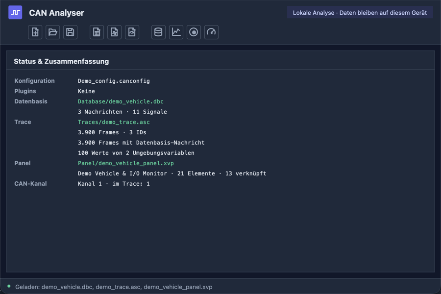
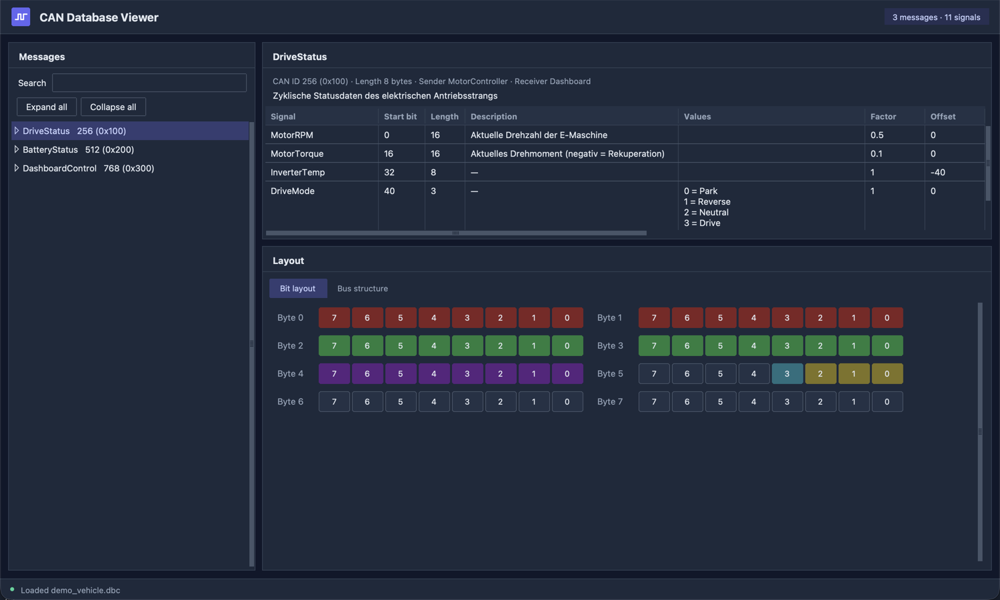
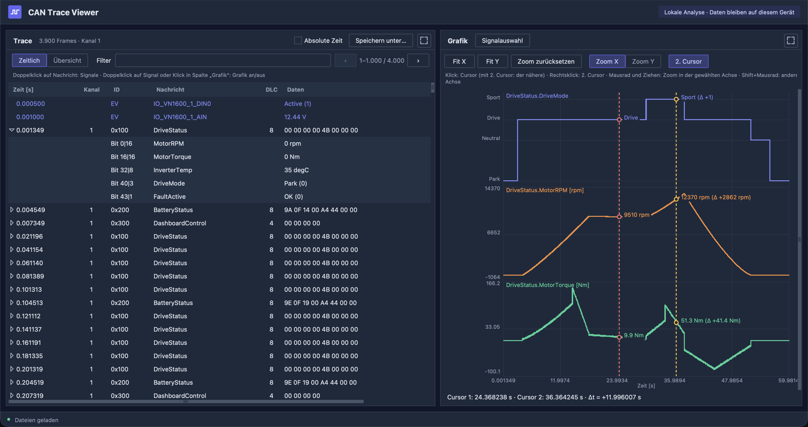
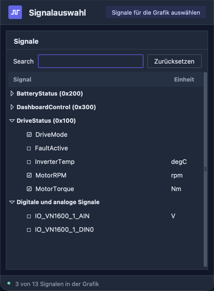
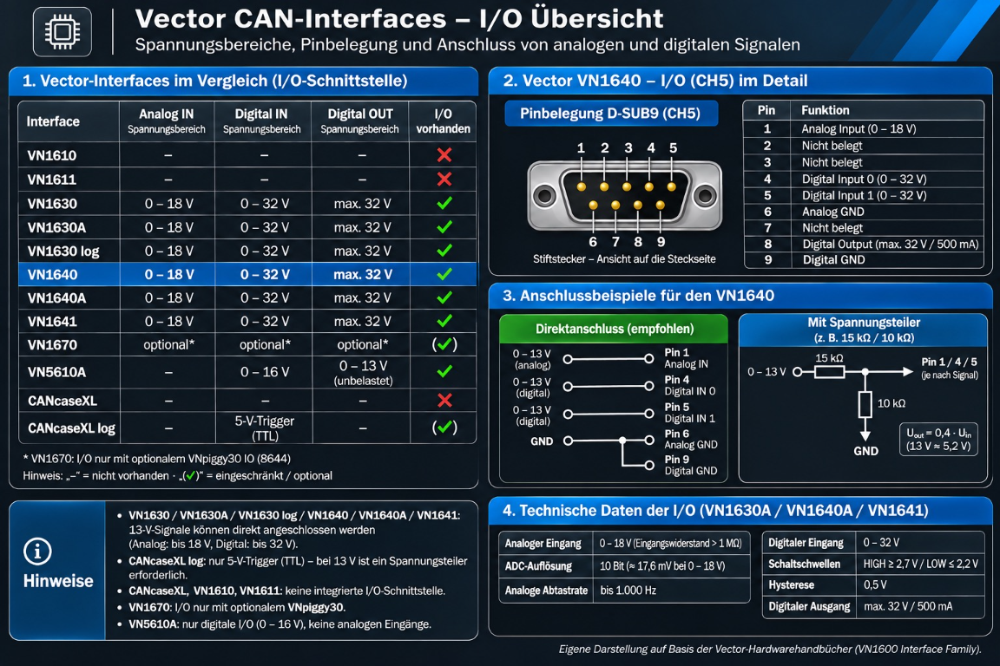
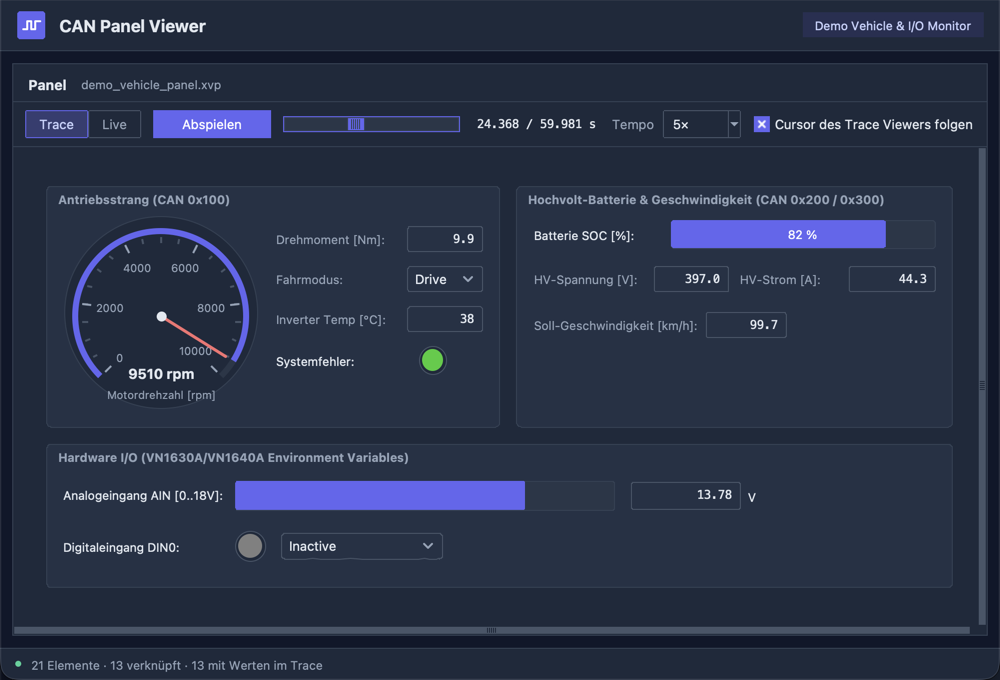

# CANtrix

Der CANtrix ist ein Werkzeug zum Analysieren von CAN- und CAN-FD-Botschaften. Er läuft unter Windows und macOS. Für den Start aus dem Quellcode wird Python 3 mit Tkinter benötigt. Für Live-Aufnahmen und TRACE32 kommen je nach Schnittstelle weitere Pakete hinzu. Alle Daten bleiben auf dem eigenen Rechner.

- **Database Editor:** zeigt CAN-Datenbasen (DBC, ARXML, HTML-Message-Catalogue) mit Nachrichten, Signalen, Bitlayout und Busstruktur.
- **Trace Viewer:** öffnet CAN-Traces (ASC, BLF, MF4, TRC, candump, BUSMASTER, SLCAN, CSV, PCAP; siehe „Unterstützte Trace-Formate“), dekodiert die Signale mit der Datenbasis und zeigt ihren Verlauf als Grafik mit Zoom und Cursor.
- **Panel Viewer:** zeigt Vector-Panels (`.xvp` aus dem CANalyzer/CANoe Panel Designer) mit Werten aus dem Trace: Zeigerinstrument, Zahlenfelder, Auswahlfelder, LEDs und Balken, verknüpft mit Signalen oder Umgebungsvariablen.
- **Logic Analyzer:** zeichnet digitale und analoge Signale mit einem sigrok-pico auf oder die CAN-RX-Leitung mit einem USBtingo (mit CAN-Dekodierung) und öffnet Sigrok-Dateien (`.sr`).
- **Plugins:** startet eigene Python-Skripte, auf Wunsch mit dem geladenen Trace.
- **Konfigurationen:** Datenbasis, Trace, Panel, Fensteranordnung und Plugins lassen sich als `.canconfig` speichern und wieder laden.


© 2026 Frank Hoheisel


## Installation

Die Aufzeichnung im Trace Viewer (Datenquelle "Live") benötigt Python-CAN. Mit folgenden Befehl kann Python-CAN im Terminal Fenster installiert werden.

```bash
pip3 install --user python-can
```

Je nach CAN-Gerät (Auswahl unter "Einstellungen > CAN Trace Recorder > Schnittstelle") wird zusätzlich benötigt:

- **Vector-Geräte (VN, VX, VH, … – jedes Modell, das der Vector-Treiber unterstützt):** der Vector-Treiber (Vector XL Driver Library, vxlapi64.dll), nur unter Windows.
- **USBtingo:** das Plugin `python-can-usbtingo` und unter macOS die Bibliothek libusb (Windows bringt sie mit); ein eigener Treiber ist nicht nötig.
- **OBDLink MX+ / ELM327:** `pyserial` und ein serieller Port des Adapters.
- **sigrok-pico (Logic Analyzer):** `pyserial` und ein Raspberry Pi Pico mit der Firmware sigrok-pico, siehe Kapitel „Logic Analyzer“.
- **TRACE32 (Variablen im Trace Viewer):** das Paket `lauterbach-trace32-rcl` (`pip3 install --user lauterbach-trace32-rcl`), siehe Kapitel „TRACE32-Variablen“.

```bash
pip3 install --user python-can-usbtingo
brew install libusb   # nur macOS
```

Ist `brew` nicht im PATH (Apple Silicon), funktioniert `/opt/homebrew/bin/brew install libusb`. Ohne libusb meldet "Verbindung testen" "cannot find a suitable libusb-1.0".

Die Installationsskripte installieren `python-can` sowie die optionalen Pakete `python-can-usbtingo`, `pyserial`, `lauterbach-trace32-rcl` und `bleak` (BLE Monitor).

Alternativ per Doppelklick:

- Windows: Batch/01 - install_python-can_Windows.bat
- macOS: Batch/01 - install_python-can_MacOS.command (beim ersten Start ggf. Rechtsklick > Öffnen, falls macOS die Datei blockiert)

Die Verzeichnisstruktur für eigene Dateien (`Database`, `Nodes`, `Panel`, `Plugins`, `Traces`) legt ein Skript an; vorhandene Ordner bleiben unverändert:

- Windows: Batch/00 - create_folders_Windows.bat
- macOS: Batch/00 - create_folders_MacOS.command

## Start

```bash
python3 Sourcen/CANtrix.py
```

Oder per Doppelklick:

- Windows: Batch/02 - start_CANtrix_Windows.bat
- macOS: Batch/02 - start_CANtrix_MacOS.command (beim ersten Start ggf. Rechtsklick > Öffnen, falls macOS die Datei blockiert)

Optional kann eine Konfiguration übergeben werden, z. B. `"Batch\02 - start_CANtrix_Windows.bat" meine.canconfig`


### App und EXE bauen

Die Skripte unter `Batch/03` bauen die App oder EXE für das jeweilige Betriebssystem. Unter `Batch/05` entsteht zusätzlich `CANtrix.zip`. Der macOS-Lauf baut die App lokal und holt die Windows-EXE über GitHub Actions. Dafür muss `gh` angemeldet sein. GitHub baut den gepushten Stand des Branches. Die `05`-Skripte räumen ihre temporären Arbeitsdateien beim Beenden auf.

## Bedienung

### Hauptfenster

Datenbasen, CAN-Traces und Panel werden nur im Hauptfenster geöffnet, über das Menü "Datei" oder die Symbole in der Kopfleiste. Database Editor, Trace Viewer und Panel Viewer werden über das Menü "Ansicht" geöffnet und verwenden alle dieselben Datenbasen und denselben Trace.

Die Symbole unter "CANtrix" in der Kopfleiste:

- Die ersten drei erstellen eine neue Konfiguration, laden eine Konfiguration und speichern sie (ohne geladene Konfiguration wird nach dem Dateinamen gefragt).
- Die nächsten drei öffnen die Fenster "Datenbasen" und "CAN-Traces" und ein Panel.
- Die Symbole rechts davon öffnen Database Editor, Trace Viewer (Tabelle), Graph Viewer (Grafik), Panel Viewer, Generator, Logic Analyzer und BLE Monitor.
- Danach folgt der Umschalter Start/Stop (im Ruhezustand das Dreieck zum Starten, während der Aufzeichnung bzw. des Abspielens hervorgehoben das Quadrat zum Beenden) sowie der Umschalter für die Datenquelle: er zeigt die aktive Quelle, Trace (Seite) oder Live (Funkwellen, hervorgehoben), daneben steht "Offline" (Trace) bzw. "Online" (Live); ein Klick wechselt zur anderen. Ein nicht bedienbares Symbol bleibt grau.
- Rechts stehen Zeitschieber, Zeit, Tempo und der Haken "Cursor des Trace Viewers folgen".



### Datenbasen

Eine Konfiguration kann mehrere Datenbasen enthalten. "Datei > Datenbasen…" (Cmd/Ctrl+D) oder das Symbol in der Kopfleiste öffnet das Fenster "Datenbasen": oben die Liste mit Datei, CAN-Kanal, Inhalt (Anzahl der Nachrichten und Signale) und Pfad, unten das Formular.

- "Auswählen…" fügt eine oder mehrere Dateien als neue Datenbasen hinzu; sie bekommen den im Formular gewählten CAN-Kanal.
- Zum Ändern eine Zeile anklicken, Datei oder CAN-Kanal ändern und "Übernehmen" wählen; "Entfernen" nimmt sie aus der Liste, "Neu" leert das Formular.
- CAN-Kanal "Alle Kanäle": Die Datenbasis gilt für alle Frames. Mit einem Kanal gilt sie nur für die Frames dieses Kanals und hat dort Vorrang. So lassen sich z. B. zwei Busse mit gleichen IDs, aber verschiedenen Nachrichten auswerten.
- Jede Änderung gilt sofort für alle Fenster; gespeichert wird die Liste mit der Konfiguration. Unveränderte Dateien werden dabei nicht neu eingelesen.
- Im Hauptfenster steht jede Datenbasis mit ihrem Kanal und Inhalt; eine Datei, die nicht gelesen werden konnte, ist rot markiert. Der Database Editor gruppiert die Nachrichten nach Datenbasis.

### CAN-Traces

Eine Konfiguration kann mehrere CAN-Traces enthalten, die nach dem Laden als ein einziger Trace behandelt werden. "Datei > CAN-Traces…" (Cmd/Ctrl+O) oder das Symbol in der Kopfleiste öffnet das Fenster "CAN-Traces", aufgebaut wie das Fenster "Datenbasen": oben die Liste mit Datei, Inhalt (Frames, Startzeit, Beginn im Gesamt-Trace) und Pfad, unten das Formular mit Datei, "Auswählen…" (auch mehrere Dateien), Neu, Hinzufügen/Übernehmen, Entfernen.

- Traces mit Startzeit (z. B. die `date`-Zeile in ASC) werden über die absolute Zeit ausgerichtet: Der früheste beginnt bei 0 s, die anderen entsprechend später. So passen aufeinanderfolgende Aufzeichnungen ebenso wie gleichzeitige von verschiedenen Bussen zusammen, die Reihenfolge in der Liste spielt dann keine Rolle.
- Ein Trace ohne Startzeit (z. B. SLCAN) schließt an das Ende des vorherigen in der Liste an.
- Frames und Werte von Umgebungsvariablen aller Traces werden nach Zeit zusammengeführt; Trace Viewer, Panel Viewer und Status zeigen einen Trace. Im Hauptfenster steht jede Datei mit Frames, Startzeit und Beginn im Gesamt-Trace.
- Jede Änderung gilt sofort; gespeichert wird die Liste mit der Konfiguration. Unveränderte Dateien werden nicht neu eingelesen.
- Bei mehreren Traces oder einem gewählten Zeitbereich erzeugt der Plugin-Modus **Trace übergeben** eine temporäre ASC-Datei mit den entsprechenden Daten.

### Konfigurationen

Über das Menü "Datei" lassen sich Datenbasis, Trace, Panel, Plugins und Fenstereinstellungen als Konfiguration (`.canconfig`) speichern und wieder laden. Mit "Neue Konfiguration" beginnt man leer. Die letzten 5 Konfigurationen stehen im Menü "Datei" direkt zur Auswahl.

### Database Editor

Der Database Editor zeigt die Nachrichten der Datenbasis mit ihren Signalen (Startbit, Länge, Faktor, Offset, Werte-Texte, Beschreibung …) und das Bitlayout jeder Nachricht. Nach den Nachrichten folgt der Eintrag "Environment variables" mit den Umgebungsvariablen einer DBC (Typ, Minimum, Maximum, Einheit, Startwert, Beschreibung, Werte-Texte, Zugriff und Knoten).

**Bearbeiten (nur DBC-Dateien):** Der Database Editor zeigt ARXML- und HTML-Datenbasen nur an (schreibgeschützt).

Bei genau zwei geladenen Datenbasen zeigt **Nur Unterschiede anzeigen** die abweichenden Nachrichten und Signale. Nachrichten werden anhand der CAN-ID verglichen, Signale anhand ihres Namens. **Grün** kennzeichnet hinzugefügte, **Rot** entfernte und **Blau** geänderte Einträge. Die Datei mit dem jüngeren Änderungszeitstempel gilt als neuer Stand. Bei gleichen oder fehlenden Zeitstempeln bleiben einseitig vorhandene Einträge ungefärbt. Die Farblegende erscheint beim Überfahren der Checkbox mit der Maus.

**Speichern als DBC…** exportiert die Datenbasis der ausgewählten Nachricht, des Signals oder der Umgebungsvariablen. Ohne Auswahl wird die erste geladene Datenbasis verwendet. Bei einer DBC wird der vollständige Text einschließlich ungespeicherter Änderungen kopiert. HTML und ARXML werden aus den eingelesenen Nachrichten, Signalen, Wertetabellen und verfügbaren Knotenangaben konvertiert.

Bei der Konvertierung gehen Informationen außerhalb des eingelesenen Modells verloren, etwa zusätzliche Knoten, herstellerspezifische Attribute und die Bus- oder PDU-Hierarchie. Namen werden bei Bedarf in eindeutige DBC-Bezeichner mit bis zu 32 Zeichen umgewandelt. Fehlende Angaben zu Signalen werden mit Little Endian, unsigned, Faktor 1, Offset 0 und Grenzen 0 ergänzt. Wertetabellen übernehmen ganzzahlige Werte. Ohne Angabe zum Frameformat wird CAN FD ab mehr als acht Datenbytes und Extended CAN bei IDs über 0x7FF abgeleitet. Doppelte CAN-IDs desselben Adressierungsformats oder ungültige Signalpositionen werden mit einer Fehlermeldung gemeldet.

**Speichern als ARXML…** exportiert die Nachrichten und Signale derselben Auswahl als AUTOSAR R22-11. Der Export erzeugt CAN-Cluster, physische Kanäle, Frames, I-PDUs und Signalzuordnungen. Er übernimmt Bitposition, Länge, Byte-Reihenfolge, Vorzeichen und verfügbare lineare Skalierung, Grenzen und Einheiten. Nachrichten ohne Busangabe landen im Cluster „CAN“.

Der ARXML-Export lässt Wertetabellen, Kommentare, Umgebungsvariablen, ECU-Zuordnungen und Multiplexierungsregeln weg. Die Bitpositionen der Signale bleiben erhalten. Bei fehlender Byte-Reihenfolge wird Little Endian verwendet. Wenn das Frameformat fehlt, wird CAN FD aus einer Nutzlast von mehr als acht Bytes und die Extended-Adressierung aus der ID abgeleitet. Doppelte IDs im selben Cluster und Adressierungsformat führen zu einem Fehler.

- Unter der Kopfleiste: "New" (legt eine neue, leere DBC-Datei an und fügt sie den Datenbasen hinzu), "Save" (schreibt alle geänderten Dateien), "Undo"/"Redo" (auch Cmd/Ctrl+Z und Cmd/Ctrl+Y).
- Links "New message" und "New variable". Über der Signaltabelle "Edit…", "New signal", "Duplicate" und "Delete" für die Auswahl (Nachricht, Signal oder Umgebungsvariable). Ein Doppelklick auf Baumeintrag oder Tabellenzeile öffnet "Edit…". Bei mehreren Datenbasen gilt der Befehl für die Datei der Auswahl, "New message" und "New variable" ohne Auswahl für die erste DBC-Datei.
- Im Bitlayout wählt ein Klick auf ein Bit das Signal. Das gewählte Signal lässt sich mit der Maus verschieben (Ziehen) oder in der Länge ändern (Umschalt+Ziehen); Intel- und Motorola-Signale werden dabei richtig behandelt. Die neue Lage wird erst beim Loslassen übernommen, und nur, wenn das Signal in die Nachricht passt.
- IDs über 0x7FF gelten als Extended-IDs und bekommen das Extended-Flag (Bit 31) wie in DBC-Dateien üblich.
- Geändert werden nur die betroffenen Zeilen der Datei. Alles andere (Attribute, Knotenliste, Signalgruppen, Kommentare, Reihenfolge) bleibt unverändert. Wird eine Nachrichten-ID oder ein Signalname geändert, werden Kommentare, Werte-Texte und Attribute, die darauf verweisen, mitgeändert. Neue Sender, Empfänger und Zugriffsknoten werden in `BU_` eingetragen. Nicht kopiert oder umbenannt werden Verweise in Signalgruppen (`SIG_GROUP_`) und relationalen Attributen (`BA_REL_`). Hat eine Datei gemischte Zeilenenden, schreibt der Editor einheitlich die vorherrschenden.
- Gespeichert wird erst mit "Save". Vor dem ersten Speichern einer Datei legt der Editor `<Datei>.bak` an. Danach liest der Analyzer die Datenbasen neu ein, sodass Trace Viewer, Panel Viewer und Status die Änderung sehen. Beim Schließen des Fensters, beim Laden einer anderen Konfiguration und beim Beenden fragt der Analyzer nach ungespeicherten Änderungen.



### Trace Viewer

Trace-Tabelle und Grafik sind zwei getrennte Fenster, die über "Ansicht > Trace Viewer" und "Ansicht > Graph Viewer" (oder die Symbole in der Kopfleiste) geöffnet werden. Beide arbeiten mit denselben Daten, derselben Signalauswahl und denselben Cursorn; man kann auch nur eines davon öffnen. Geschlossen wird jedes Fenster für sich.

Die Trace-Tabelle zeigt neben den CAN-Frames auf Wunsch auch die Werte der Umgebungsvariablen aus dem Trace (Haken "Umgebungsvariablen" in der Titelzeile des Trace-Bereichs, anfangs aus) und CAN-Fehler (Haken "CAN-Fehler", anfangs aus). Zuerst zu den Umgebungsvariablen: z. B. die digitalen und analogen Ein- und Ausgänge eines VN1600 (`ev IO_VN1600_1_DIN0 = 1`, `ev IO_VN1600_1_AIN = 12.44`). Sie stehen zeitlich zwischen den Frames, in der Spalte ID steht "EV", in der Spalte Daten der Wert, mit Einheit oder Werte-Text aus der Datenbasis (z. B. `12.44 V`, `Active (1)`). In der Übersicht hat jede Variable eine Zeile mit ihrem letzten Wert und der Anzahl der Werte. Der Filter findet sie über ihren Namen; die Auswahl des CAN-Kanals blendet sie nicht aus, da sie zu keinem Kanal gehören. Die Signalauswahl für die Grafik bietet sie unabhängig vom Haken an.

CAN-Fehler (Error Frames) stehen rot zeitlich zwischen den Frames: in der Spalte ID "ERR", in der Spalte Daten die Beschreibung (z. B. `Error Frame ECC: 10100010` oder bei SocketCAN `Error Frame: Bus off`). Sie gehören zu einem Kanal und folgen deshalb dem CAN-Kanal-Filter; in der Übersicht hat jeder Kanal eine Zeile mit der Anzahl. Gelesen werden sie aus Vector ASC (`ErrorFrame`), BLF, candump und PCAP/PCAPNG; beim Speichern kommen sie nur in ASC mit. Die Frame-Zahl zählt weder Umgebungsvariablen noch Fehler.



Über "Signalauswahl" in der Titelzeile des Graph Viewers öffnet sich ein eigenes Fenster mit allen Signalen, nach Botschaften gruppiert (Name und ID, anfangs zugeklappt). Danach folgen die Gruppe "Digitale und analoge Signale" (Umgebungsvariablen der Ein- und Ausgänge, z. B. `IO_VN1600_1_DIN0`, `IO_VN1600_1_AIN`) und, falls vorhanden, die Gruppe "Umgebungsvariablen" mit allen übrigen. Ein Klick auf ein Signal nimmt es in die Grafik auf oder entfernt es; die Suche zeigt nur passende Signale und klappt ihre Gruppen auf. "Zurücksetzen" entfernt alle Signale aus der Grafik. Mit dem Auswahlfeld "Fenster" in der Titelzeile der Grafik lassen sich bis zu 5 Grafik-Fenster anlegen, es ist immer nur eines sichtbar. Jedes hat eigene Signale, Zoom und Cursor, alles wird in der Konfiguration gespeichert. Ebenso hat der Trace-Bereich ein Auswahlfeld "Fenster" mit bis zu 5 Trace-Fenstern (je eigene Ansicht, Filter, Seite, Haken und aufgeklappte Nachrichten). Umgebungsvariablen lassen sich auch in der Trace-Tabelle über die Spalte "Grafik" an- und abwählen. Ein einzelnes Signal lässt sich auch direkt in der Grafik entfernen: Rechtsklick in seine Spur, dann "„Name“ aus der Grafik entfernen".



In der Grafik setzt ein Klick den Cursor; seine Zeit steht unter der Grafik. Mit dem Umschalter "Zoom X" (Standard) / "Zoom Y" in der Werkzeugleiste der Grafik wird gewählt, welche Achse Mausrad und Ziehen zoomen: bei "Zoom X" die Zeitachse, bei "Zoom Y" die Werteachse der Kurve unter der Maus. Shift+Mausrad zoomt jeweils die andere Achse. "Fit X", "Fit Y" und "Fit all" stellen die Achsen wieder ein. Die Wahl wird mit der Konfiguration gespeichert.

Der Button "2. Cursor" schaltet einen zweiten Cursor (gelb) hinzu. An ihm steht neben dem Wert jedes Signals die Differenz zum ersten Cursor (z. B. `9422 rpm (Δ +5817 rpm)`), unter der Grafik die Zeiten beider Cursor und ihre Differenz Δt. Ist er aktiv, versetzt ein Klick den näher gelegenen Cursor; ein Rechtsklick (unter macOS auch Ctrl+Klick) öffnet ein Menü, dessen Eintrag "2. Cursor hier setzen" immer den zweiten Cursor setzt und ihn bei Bedarf einschaltet. Beide Cursor werden mit der Konfiguration gespeichert.

"Grafik in die Zwischenablage kopieren" im selben Menü legt die Zeichenfläche als Bild in die Zwischenablage (macOS und Windows), so wie sie angezeigt wird (Zoom, Cursor, hell oder dunkel). Müsste man zu weiteren Signalen rollen, werden die Spuren für das Bild so gestaucht, dass alle darauf sind. Die Zeile mit den Cursorzeiten unter der Grafik gehört nicht dazu.

Mit dem Haken "Uhrzeit" in der Titelzeile des Trace-Bereichs zeigt die Tabelle ganz links zusätzlich Datum und Uhrzeit jedes Frames (`dd.mm.jjjj hh:mm:ss.xxx`), daneben weiterhin die Zeit in Sekunden. Standardmäßig ist der Haken aus; die Einstellung wird mit der Konfiguration gespeichert. Die absolute Zeit ergibt sich aus dem Messbeginn im Trace (bei ASC die Zeile `date`, z. B. `date Tue Aug 11 01:32:42.560 pm 2026`) plus der Zeit des Frames; auch negative Zeitstempel werden berücksichtigt. Enthält der Trace keinen Messbeginn (z. B. SLCAN), steht dort "—".

Mit dem Button "Beschreibung" in der Titelzeile des Trace-Bereichs zeigt die Tabelle ganz rechts eine zusätzliche Spalte "Beschreibung" mit den Kommentaren aus der Datenbasis: bei Nachrichten die Beschreibung der Nachricht, bei Signalen die des Signals, bei Umgebungsvariablen die der Variablen. Der Button ist standardmäßig aus; die Einstellung wird mit der Konfiguration gespeichert (je Trace-Fenster).

Unter "Einstellungen > CAN Trace Viewer" wird der CAN-Kanal gewählt, den der Trace Viewer anzeigt (oder "Alle Kanäle"). Die Auswahl wird in der Konfiguration gespeichert. Enthält ein geladener Trace nur einen Kanal, wird dieser automatisch gewählt.

Im Hauptfenster schaltet **Trace/Live** den Trace Viewer und den Panel Viewer zwischen geladenem Trace und Live-Aufzeichnung um. **Start** öffnet bei Bedarf den Trace Viewer und startet die Aufzeichnung über Vector, USBtingo oder OBDLink / ELM327. Tabelle und Grafik folgen der Aufzeichnung, bis du zurückblätterst oder zoomst. **Fit X** stellt das Folgen wieder her. Der Recorder hält bis zu 100.000 CAN-Frames. Beim Wechsel zu **Trace** endet die Aufzeichnung. Sie bleibt bis zum nächsten Start unter **Live** sichtbar. **Löschen** leert die Live-Aufzeichnung auch während der Aufnahme und setzt die Zeitbasis zurück.

Unter **Einstellungen → CAN Trace Recorder** wählst du Schnittstelle und Bitraten. Bei Vector übernimmt **Geräte suchen** Seriennummer und Kanal des ausgewählten Geräts. Bei USBtingo kann die USB-Seriennummer leer bleiben, um das erste Gerät zu verwenden. Die OBD-Schnittstelle verwendet einen seriellen Port. Die Einstellungen werden in den Programmeinstellungen gespeichert.

**Verbindung testen** zeigt das Ergebnis im Dialog. Der Punkt ist vor und während des Tests grau, bei Erfolg grün und bei einem Fehler rot.

Neue Recorder-Einstellungen verwenden wie CANcase standardmäßig Vector, Kanal 0 und CAN FD mit 500.000 / 2.000.000 Bit/s. Für Vector kann der App-Name gesetzt werden (Standard „CANoe“). Im Vector-CAN-FD-Modus sind SJW, TSEG1 und TSEG2 für Arbitrierung und Datenphase einstellbar. Die Standardwerte sind 15 / 64 / 15 und 8 / 11 / 8. **Aus Bitrate berechnen** ermittelt die Werte für die eingetragenen Raten. USBtingo verwendet die Bitraten und die optionale USB-Seriennummer. Bei einer parallelen CANoe-Verbindung müssen die Vector-Timing-Werte zur dortigen Kanalkonfiguration passen.

### OBDLink MX+ und ELM327

Unter **Einstellungen → CAN Trace Recorder** die Schnittstelle **OBDLink / ELM327** wählen und den seriellen Port eintragen, zum Beispiel `/dev/cu.OBDLinkMX…` unter macOS oder `COM7` unter Windows. Die serielle Baudrate (Standard 115200) ist getrennt von der CAN-Bitrate. Der Adapter muss als serieller Port verfügbar sein. Für den Betrieb aus dem Quellcode installieren die Skripte unter `Batch/01` das Paket `pyserial`.

**Verbindung testen** prüft die Kommunikation mit dem Adapter und den Start des passiven Monitors, auch auf einem stillen CAN-Bus. In der Live-Aufzeichnung werden klassische CAN-Datenframes auf einem Kanal erfasst. Der Generator unterbricht den Monitor kurz zum Senden. ELM327-Firmware ohne USER1-Unterstützung verwendet die Standardprotokolle bei 250 oder 500 kbit/s. Die empfangbare ID-Breite hängt in diesem Fall vom aktiven Protokoll ab.

Die Zeitstempel entstehen am Rechner und können durch die serielle Übertragung oder Bluetooth verzögert sein. Bei hoher Buslast und beim Senden können Frames fehlen. Der Adapter liefert weder CAN FD noch Error-Frames oder eine verlässliche Rx-/Tx-Kennung. Die Funktion wurde mit einer seriellen Schein-Gegenstelle geprüft.

### Vector I/O

**Einstellungen > Vector I/O Configuration** verwaltet die CH5-Belegung eines VN1640 oder VN1640A. Unter **Übersicht** lässt sich ein vom XL-Treiber erkanntes Gerät auswählen oder die Seriennummer manuell eingeben. Die Zykluszeit ist von 1 bis 100 ms einstellbar. Unter **Pin-Konfiguration** lassen sich der Analogeingang, beide Digitaleingänge und der Digitalausgang einzeln aktivieren und benennen.



**OK** legt für die aktiven Pins eine zusätzliche DBC an und lädt sie in die aktuelle Konfiguration. Die Geräte-, Pin- und Zyklusparameter werden mit der `.canconfig` gespeichert. Der Dialog erstellt die Konfiguration und DBC-Definitionen. Die zyklische Abfrage und Ausgabe an der Hardware sind ein separater Betriebsmodus, der hier noch fehlt.

### TRACE32-Variablen

Im Zustand Live kann der Trace Viewer zusätzlich Variablen eines laufenden Lauterbach-TRACE32-Debuggers lesen und in der Trace-Tabelle anzeigen (Haken "TRACE32" in der Titelzeile des Trace-Bereichs, Einstellungen unter "Einstellungen > TRACE32").

**Voraussetzungen**

- Python 3.7 oder neuer (das Paket `lauterbach-trace32-rcl` läuft nicht mit Python 3.6; Fehlermeldung "future feature annotations is not defined").
- Das Paket für die Remote API: `pip3 install --user lauterbach-trace32-rcl` (Windows: `py -3.11 -m pip install lauterbach-trace32-rcl`). Für Starts aus dem Quellcode installieren die Hilfsskripte unter `Batch/01` auch die TRACE32-RCL-Bibliothek. Neu gebaute Apps und EXE-Dateien enthalten sie bereits.
- Ein laufender TRACE32-Debugger mit aktiver Verbindung zum Zielsystem.

**TRACE32 konfigurieren**

TRACE32 muss die Remote Control (RCL) über TCP anbieten. In der TRACE32-Konfiguration (`config.t32`) prüfen bzw. eintragen:

```
RCL=NETTCP
PORT=20000
```

Host und Port im Dialog müssen dazu passen; für eine lokale Verbindung gilt `localhost` und Port 20000. Das Zielsystem muss für den gewünschten Zustand lesbar sein. Ob Variablen während der Programmausführung gelesen werden können, hängt vom Zielsystem und der TRACE32-Konfiguration ab; falls nötig, in TRACE32 die passende Memory-Access-Einstellung für den Controller wählen.

**Variablen eintragen und auslesen**

1. Haken "TRACE32" setzen. Ohne eingetragene Variablen öffnet sich der Dialog, sonst über "Einstellungen > TRACE32".
2. Host, Port, Variablen (eine pro Zeile oder mit Komma getrennt, z. B. `Status_st.externalTemperature_f32`) und das Abfrageintervall in Millisekunden (Standard 100) eintragen.
3. Die Aufzeichnung im Hauptfenster starten (Datenquelle "Live"). Gelesen wird nur während der Aufzeichnung.

Mit **Watch-Datei öffnen…** lassen sich `VAR.ADDWATCH`-Einträge aus einer `.cmm`-Datei in die Variablenliste übernehmen. Die eigenen Einträge bleiben in der Liste. Während der Aufzeichnung zeigt die TRACE32-Zeile den Verbindungsstatus mit einem grauen, grünen oder roten Punkt.

Mit **OK** legt der Analyzer für die importierten Symbole eine zusätzliche DBC im Ordner `Database/TRACE32` an und lädt sie in die aktuelle Konfiguration. Die Datei heißt nach der Konfiguration (`TRACE32-Watch-<Name>.dbc`, entsprechend `Database/VectorIO/Vector-IO-<Name>.dbc` für Vector I/O) und wird bei jeder Änderung überschrieben; Änderungen von Hand gehen dabei verloren. Beim Speichern unter einem anderen Namen entsteht eine eigene Datei. Die DBC definiert lesbare Umgebungsvariablen mit dem Präfix `TRACE32_`. Bei angepassten DBC-Namen steht der Originalname im Kommentar. Während der Live-Aufzeichnung erscheinen erfolgreich gelesene Werte im Trace Viewer als Umgebungsvariablen und in entsprechend verknüpften Panels. Die Messwerte werden beim ASC-Export mitgespeichert.

TRACE32 muss die Variablennamen im geladenen Symbolsatz auflösen können. Skalare werden als Werte gelesen. Kann TRACE32 ein Symbol nur als Speicherbereich lesen, zeigt der Trace Viewer die Bytes als Liste an. Ein C-Präprozessor-Makro (`#define`) ist nur lesbar, wenn es ein entsprechendes Symbol im Zielspeicher gibt.

**Anzeige**

Wenn sich ein Wert ändert, entsteht eine Zeile (grün, in der Spalte ID "T32", in der Spalte Daten der Wert). In der Übersicht hat jede Variable eine Zeile mit dem letzten Wert und der Anzahl der Änderungen. Die Zeit ist abfragebasiert und nicht zyklussynchron zum CAN-Frame.

**Fehlerhinweise**

- Verbindungsfehler in der Statuszeile: RCL-Konfiguration, Host, Port und Firewall prüfen.
- "ERR: …" als Wert: Ausdruck bzw. Symbol prüfen; bei einer Struktur ein einzelnes Feld angeben.
- Kein CAN-Empfang: Vector-Treiber, Gerät, Kanal und Bitrate prüfen (siehe Installation und "Einstellungen > CAN Trace Recorder").

### Panel Viewer

Mit "Datei > Panel öffnen…" wird ein Vector-Panel (`.xvp`) geladen und im Panel Viewer angezeigt. Seine Elemente zeigen die Werte der verknüpften Signale und Umgebungsvariablen (z. B. `ev IO_VN1600_1_AIN = 12.44` im Trace) zu einem Zeitpunkt. Der Zeitpunkt wird so gewählt (Abspielen, Zeitschieber und Cursor-Folgen funktionieren auch ohne geladenes Panel; dann bleibt der Panel Viewer geschlossen und das Hauptfenster hält die Zeit, der Trace Viewer folgt ihr):

Panel-Buttons eines Panels (z. B. "config") öffnen beim Anklicken die dort hinterlegten Panels, jedes in einem eigenen Panel-Viewer-Fenster. Die Dateien werden im Ordner des Panels mit dem Button gesucht. Ein bereits geöffnetes Panel kommt nach vorn.

Es können mehrere Panels gleichzeitig geöffnet werden (Mehrfachauswahl im Dateidialog oder "Panel öffnen…" mehrmals): jedes bekommt ein eigenes Panel-Viewer-Fenster und wird in der Konfiguration gespeichert. Alle Panels zeigen dieselbe Zeit; Zeitschieber, Start/Stop und Cursor-Folgen gehören zum ersten (obersten) offenen Panel. Wird ein Panel-Fenster geschlossen, verschwindet sein Panel aus der Konfiguration. Auf der Kommandozeile kann `-p` mehrfach angegeben werden.

- mit dem Zeitschieber im Hauptfenster (daneben die Zeit),
- per "Start" und "Stop" im Hauptfenster (Zustand "Trace"; das Tempo (0,5× bis 1000× oder ∞ = unendlich, springt sofort ans Ende; Standard 100×) steht daneben im Hauptfenster, die Leertaste startet und hält ebenfalls an; das Abspielen beginnt immer am Anfang des Traces),
- oder, bei gesetztem Haken "Cursor des Trace Viewers folgen" (ebenfalls im Hauptfenster), am Cursor der Grafik im Trace Viewer.

Trace und Grafik im Trace Viewer folgen der Zeit: Beim Abspielen zeigt die Tabelle nur die Frames bis zur aktuellen Zeit (und blättert mit), die Grafik nur die Kurven bis dahin (die Zeitachse bleibt gleich). Nach "Stop" ist wieder alles zu sehen. Wird der Zeitschieber bewegt, wird nichts ausgeblendet: In der Grafik wandert nur der Cursor, die Tabelle springt zu dieser Zeit und zeigt die Zeile in der Mitte. Ein neuer Trace, der Wechsel der Datenquelle oder das Schließen des Panel Viewers hebt das auf. In der Ansicht "Feste Position" (eine Zeile je Nachricht) werden immer alle Frames gezeigt.

Ist im Hauptfenster "Live" gewählt, zeigt der Panel Viewer stattdessen die Nachrichten, die der Trace Viewer gerade aufzeichnet (jeweils den zuletzt empfangenen Wert); Zeitschieber und Abspielen sind dann gesperrt. Live stehen auch die aus einer TRACE32-Watch-Datei erzeugten Umgebungsvariablen zur Verfügung.

Fährt man mit der Maus über ein Element, steht in der Statusleiste, womit es verknüpft ist und welchen Wert es hat.



### Generator

"Ansicht > Generator" (oder das Symbol in der Kopfleiste) öffnet das Fenster "CAN Generator" zum Senden von CAN-Nachrichten. "Nachricht hinzufügen" öffnet eine Auswahl der Nachrichten der Datenbasis (Suchfeld, Mehrfachauswahl); der Eintrag bekommt deren ID und Länge, die Daten sind 0. "Leere Nachricht" legt einen freien Eintrag an (ohne Datenbasis direkt). Ein Rechtsklick auf eine Frame-Zeile der Trace-Tabelle ("Zum Generator hinzufügen"; auch auf eine Signalzeile darunter) übernimmt ID und Daten des Frames. Die ID steht als `0x…` im Feld, Eingaben mit oder ohne `0x` gelten als hexadezimal. Je Eintrag gibt es:

- ID und Daten (hexadezimal). Ist die ID in der Datenbasis, steht ihr Name dabei, und "Signale…" öffnet einen Dialog, in dem die physikalischen Werte der Signale (bei Wertetabellen als Auswahl) eingetragen werden; die Daten werden daraus berechnet. IDs über 0x7FF werden als Extended-Frames gesendet, mehr als 8 Bytes als CAN FD (CAN-FD-Modus unter "Einstellungen > CAN Trace Recorder" nötig).
- "Senden" sendet einmal. Mit einer Taste (ein Zeichen oder ein Name wie `F5`, `space`) wird bei Tastendruck im Fenster gesendet (nicht, solange der Cursor in einem Eingabefeld steht).
- "Zyklisch" sendet wiederholt im eingestellten Abstand (Periode, Einheit ms); "Zyklisches Senden beenden" stoppt alle. Bei einem Fehler endet das zyklische Senden.

Gesendet wird über die Verbindung der Aufzeichnung: Datenquelle "Live" wählen und "Start" drücken. Die Einträge (ohne den Zustand "zyklisch") werden in der Konfiguration gespeichert; nichts sendet von selbst.

### Logic Analyzer

"Ansicht > Logic Analyzer" öffnet ein Fenster, das wie PulseView aufgebaut ist: oben die Zeitachse, darunter je Kanal eine Zeile.

Aufgezeichnet wird wahlweise mit einem USBtingo oder einem sigrok-pico (Auswahlfeld "Gerät"). Die Aufzeichnung wird als Sigrok-Datei (`.sr`) abgelegt.

| Gerät | Kanäle | Benötigt |
|---|---|---|
| USBtingo | die CAN-RX-Leitung, mit CAN-Dekodierung | `python-can`, `python-can-usbtingo`, unter macOS libusb |
| sigrok-pico | bis 21 digitale und 3 analoge, beliebige Signale | `pyserial` (kein sigrok-cli) |

- **Aufzeichnen:** roter Punkt startet, rotes Quadrat beendet die Aufzeichnung; danach wird sie angezeigt.
- **USBtingo:** tastet den Pegel der CAN-RX-Leitung ab (wie "USBtingoGUI > Logic"). Läuft schon eine Live-Aufzeichnung mit dem USBtingo, wird deren Verbindung mitbenutzt, sonst öffnet das Fenster den USBtingo selbst.
- **CAN-Dekodierung (nur USBtingo):** unter dem Pegelverlauf stehen die einzelnen Bits (`CAN: Bits`, Stuff-Bits blau) und die CAN-Felder (`CAN: Fields`: ID, Steuerbits, Datenbytes `DB`, CRC, ACK, EOF; auch CAN FD mit Bitratenumschaltung). Die CRC wird angezeigt, aber nicht geprüft. Bitrate, CAN FD und Datenrate (Vorgabe aus "Einstellungen > CAN Trace Recorder") bestimmen das Dekodieren; eine Änderung dekodiert neu. Nötig sind mindestens 4 Abtastwerte je Bit.

**sigrok-pico**

Ein Raspberry Pi Pico mit der Firmware sigrok-pico (github.com/pico-coder/sigrok-pico), per USB angeschlossen. Mit ihm ist das Fenster ein allgemeiner Logic Analyzer für beliebige Signale; eine CAN-Dekodierung gibt es dabei nicht.

**Achtung:** Alle Eingänge des Pico, auch die analogen, vertragen nur 3,3 V. Liefert eine Quelle 5 V (z. B. der RXD-Ausgang vieler CAN-Transceiver), ist ein Pegelwandler oder Spannungsteiler nötig. Die Masse muss verbunden sein.

| Kanal | Anschluss am Pico |
|---|---|
| D2 bis D22 (digital) | GP2 bis GP22 |
| A0 bis A2 (analog, 0 bis 3,3 V, 7 Bit) | GP26 bis GP28 |

- **Anschluss:** "Auto" sucht den Pico selbst, sonst den seriellen Port wählen oder eintragen.
- **Kanäle…:** wählt die aufzuzeichnenden Kanäle, je Gruppe auch "Alle" oder "Keine". Voreingestellt ist D2.
- **Bezeichnungen:** Das Textfeld neben jedem Kanal (im Fenster "Kanäle…") gibt ihm einen Namen, z. B. "SCL". Er steht links neben der Zeile, lässt sich auch nach der Aufzeichnung ändern und wird mit der Konfiguration gespeichert. In der gespeicherten `.sr`-Datei heißt der Kanal dann z. B. "D2 SCL" (so auch in PulseView).
- **Analoge Kanäle:** Mit 1, 2 oder 3 analogen Kanälen sind höchstens 400, 240 oder 160 kHz Abtastrate möglich, auch für die digitalen; eine höhere Wahl wird darauf begrenzt.
- **Überlauf:** Der Pico sendet die Daten schon während der Aufzeichnung über USB. Sind es zu viele (hohe Abtastrate, viele wechselnde Kanäle, häufige Pegelwechsel), bricht er ab; die Aufzeichnung bis dahin wird mit einem Hinweis angezeigt. Am wenigsten Daten fallen mit D2 bis D5 ohne analoge Kanäle an.
- **Länge:** Sehr lange Aufzeichnungen werden gekürzt (bei 21 Kanälen nach etwa 24 Millionen Abtastwerten). Beim Beenden kann der letzte Sekundenbruchteil fehlen.

**Bedienung und Dateien**

- **Abtastrate:** gilt für die nächste Aufzeichnung. "Auto" wählt beim USBtingo etwa das Zehnfache der Bitrate bzw. Datenrate, beim sigrok-pico 5 MHz (mit analogen Kanälen die höchste mögliche Rate).
- **Zoomen und Verschieben:** Mausrad zoomt, Ziehen verschiebt (auch Umschalt+Mausrad und die Bildlaufleiste), Doppelklick auf ein Bit oder Feld zoomt darauf. "Alles anzeigen" zeigt die ganze Aufzeichnung.
- **Viele Kanäle:** senkrecht rollen mit der rechten Bildlaufleiste oder dem Mausrad über den Kanalnamen.
- **Werte ablesen:** Fährt man mit der Maus über ein Bit, ein Feld oder einen analogen Kanal, stehen Bedeutung bzw. Spannung und Zeit in der Statusleiste.
- **Dateien:** Das Öffnen-Symbol lädt eine Sigrok-Datei (`.sr`, auch mit mehreren digitalen und analogen Kanälen). Dekodiert wird nur bei gewähltem Gerät USBtingo; hat die Datei mehrere digitale Kanäle, bestimmt "CAN-Kanal" den dekodierten. Enthält die Datei Kanalbezeichnungen, werden sie übernommen. Das Speichern-Symbol speichert die Aufzeichnung an einen frei gewählten Ort, beim sigrok-pico mit den aktuellen Bezeichnungen.

### BLE Monitor

"Ansicht > BLE Monitor" zeigt die empfangenen Bluetooth-Low-Energy-Advertising-Pakete: Zeit, Adresse, Name, RSSI, TX-Power, Hersteller (Company ID) und Daten. Dazu muss `bleak` installiert sein (Kapitel „Installation“); eine CAN-Schnittstelle ist nicht nötig.

- **Scannen:** das Dreieck startet, das Quadrat beendet den Scan. Mit "Laufzeit (s)" endet er von selbst (leer = bis zum Beenden). "Passiver Scan" gibt es nicht unter macOS und nicht auf jedem System.
- **Ansicht:** "Geräte" zeigt je Adresse eine Zeile mit dem letzten Paket und der Anzahl, "Pakete" jedes Paket (höchstens 2000 Zeilen). Ein Klick auf eine Zeile zeigt unten alle Daten. Ein Rechtsklick auf eine Zeile übernimmt Adresse, Name oder Service-UUID des Pakets in den Filter.
- **Filter:** Name, Adresse und Service-UUID als Textteil, Company ID (z. B. `0x004C`) und kleinster RSSI. Beim Namen lässt sich auch ein gefundener Name aus der Liste wählen; `-` zeigt die Geräte ohne Namen. "Nur Änderungen" zeigt ein Gerät nur neu, wenn sich seine Daten ändern.
- **Erklärung:** die Spalte neben den Daten und die Anzeige unten beschreiben, was in den Daten steht, soweit das Format bekannt ist: Apple (u. a. Nearby Info, Handoff, Wo ist?, AirPods), iBeacon, Microsoft, Eddystone und bekannte Bluetooth-Dienste. Apple veröffentlicht sein Format nicht; diese Angaben beruhen auf Reverse Engineering und können unvollständig oder falsch sein. Verschlüsselte Inhalte lassen sich nicht lesen, bei unbekannten Daten bleibt die Spalte leer.
- **Speichern:** schreibt die gefilterten Pakete als CSV (Trennzeichen `;`). Es werden die letzten 20000 Pakete aufbewahrt.
- **Umgebungsvariablen:** ein Rechtsklick auf eine Zeile legt für das Gerät Umgebungsvariablen an, einzeln oder alle: `Adresse_RSSI`, `Adresse_Name`, `Adresse_TX_Power` und `Adresse_Anzahl`. In den Namen gehen nur die ersten 10 Zeichen der Adresse ein (Sonderzeichen werden `_`, vor einer Ziffer am Anfang steht ein `_`); beginnen zwei Adressen gleich, bekommt das zweite Gerät `_2` hinter dem Adressteil. Ein Häkchen zeigt, dass es die Variable gibt; erneutes Anklicken entfernt sie. CANtrix schreibt sie in `Database/BLE/BLE-Monitor-<Konfiguration>.dbc` und fügt die Datei den Datenbasen hinzu; die Konfiguration speichern, damit sie erhalten bleibt.
- **Online:** mit dem Start eines Scans wechselt CANtrix in die Datenquelle "Live" (Online). Beim Ende des Scans bleibt sie so.
- **Live-Werte:** während des Scans bekommen die Variablen die Werte der empfangenen Pakete (unabhängig von den Filtern; "Anzahl" zählt seit dem letzten Leeren der Liste). In der Datenquelle "Live" zeigen sie der Panel Viewer und der Trace Viewer (Tabelle mit Haken "Umgebungsvariablen", Grafik; nur Wertänderungen). Die Signalauswahl der Grafik bietet dort alle Umgebungsvariablen der Datenbasen an, auch vor dem ersten Wert. Start ist dafür nicht nötig; ein Start leert die Aufzeichnung wie gewohnt.
- **macOS:** Statt der MAC-Adresse erscheint eine Geräte-UUID. Beim ersten Scan muss Bluetooth erlaubt werden (Systemeinstellungen > Datenschutz & Sicherheit > Bluetooth).

### Darstellung und Sprache

- "Ansicht > In die Menüleiste" (macOS) bzw. "Ansicht > In den Infobereich (Systemtray)" (Windows) blendet alle Fenster aus und zeigt das CANtrix-Symbol in der Menüleiste bzw. im Infobereich. Sein Menü öffnet Hauptfenster, Database Editor, Trace Viewer, Graph Viewer, Panel Viewer, Generator, Logic Analyzer und die Plugins der Konfiguration. Darunter stehen Start, Stop, Online und Offline sowie das Untermenü "Einstellungen". Jedes Fenster öffnet sich dabei einzeln, ohne das Hauptfenster. Eine gedockte Ansicht ist so lange aufgehoben und wird beim Verlassen wiederhergestellt; offene Fenster werden dabei neu geöffnet (eine vorhandene Live-Aufzeichnung geht nach Rückfrage verloren). Unter macOS verschwindet das Dock-Symbol, solange kein Fenster offen ist. Das Schließen des Hauptfensters blendet es dann nur aus; beendet wird über "Beenden". "Menüleiste verlassen" bzw. "Infobereich verlassen" holt die Fenster zurück. CANtrix startet immer normal.
- "Ansicht > Gedockte Ansicht" zeigt die Statusübersicht, Database Editor, Trace Viewer und Panel Viewer nicht als eigene Fenster, sondern als Fenster innerhalb des Hauptfensters. Sie lassen sich an der Titelleiste verschieben, an Rändern und Ecken in der Größe ändern, mit dem Quadrat maximieren (auch per Doppelklick auf die Titelleiste) und mit dem Kreuz schließen; ein Klick holt ein Fenster nach vorn. Die Statusübersicht kommt über "Ansicht > Hauptfenster" zurück. Position und Größe werden gemerkt und stehen in der Konfiguration. Beim Umschalten werden offene Fenster in der anderen Form neu geöffnet (eine laufende Aufzeichnung oder das Abspielen endet dabei). Hilfsfenster wie die Signalauswahl bleiben eigene Fenster.
- "Ansicht > Dark Mode" wechselt alle Fenster zwischen hellem und dunklem Design. Standard ist der Dark Mode.
- "Ansicht > Sprache" schaltet die Oberfläche zwischen Deutsch und Englisch um. Solange dort nichts gewählt wurde, richtet sich die Sprache nach dem Betriebssystem: Deutsch bei deutscher Systemsprache, sonst Englisch (auch wenn sich die Systemsprache nicht feststellen lässt).
- Beide Einstellungen bleiben für den nächsten Start gespeichert.

Unter "Info > Hilfe" erscheint diese Beschreibung im Programm.


## Unterstützte Datenbasis-Formate

Database Editor, Trace Viewer und Panel Viewer verwenden die Datenbasis, die im Hauptfenster geöffnet wird. Das Format wird an der Dateiendung erkannt; Dateien bis 100 MB werden gelesen.

| Format | Dateiendung | Zugriff |
| --- | --- | --- |
| Vector DBC | `.dbc` | lesen und schreiben |
| AUTOSAR ARXML | `.arxml` | lesen und exportieren |
| HTML-Message-Catalogue | `.html`, `.htm` | lesen |

### Vector DBC (`.dbc`)

- Nachrichten (`BO_`) mit ID, Länge und Sender.
- Signale (`SG_`) mit Startbit, Länge, Byte-Reihenfolge (Intel/Motorola), Vorzeichen, Faktor, Offset, Minimum, Maximum, Einheit, Empfängern und Multiplexing.
- Kommentare zu Nachrichten und Signalen (`CM_`) und Wertetabellen (`VAL_`).
- Umgebungsvariablen (`EV_` mit Zugriffsart, Knoten, Kommentar und Wertetabelle), die der Database Editor anzeigt und bearbeitet und der Panel Viewer z. B. für die I/O eines VN1600 nutzt.

### AUTOSAR ARXML (`.arxml`)

- CAN-Frames über ihre Frame-Triggerings, mit ID, Länge, Bus (Communication Cluster), sendenden und empfangenden Steuergeräten und Beschreibung.
- Signale aus den I-Signal-I-PDUs, mit Startposition, Länge, Byte-Reihenfolge, Datentyp, Grenzen, Einheit und Beschreibung.
- Lineare Umrechnung (Faktor/Offset) und Werte-Texte aus den Compu-Methods.

### HTML-Message-Catalogue (`.html`, `.htm`)

- Exportierte Message-Catalogues mit einem Abschnitt je Frame (Bus, ID, Länge, Sender, Empfänger).
- Signale mit Position, Datentyp, Wertebereich, Einheit, Skalierung und Berechnung sowie Werte-Texten.
- Auch die komprimierte Variante mit eingebetteten, gepackten Daten.

### Hinweise

- Es lassen sich mehrere Datenbasen gleichzeitig laden, auch gemischt aus DBC, ARXML und HTML (siehe "Datenbasen").
- Signale zeigen den realen Wert (Faktor und Offset der Datenbasis; beim HTML-Message-Catalogue wird der Offset aus der Berechnung, z. B. `PH = (DEC - 100.0)`, gelesen). In der Trace-Tabelle steht hinter dem Wert der Rohwert in Hex, z. B. `22 °C (0x7A)`; die Grafik zeigt den realen Wert.
- Zum Dekodieren werden die Datenbasen über die CAN-ID (Standard und Extended) mit den Frames des Traces verknüpft; eine Datenbasis mit CAN-Kanal nur mit Frames dieses Kanals. Kommt eine ID in mehreren Datenbasen für alle Kanäle vor, gilt die erste in der Liste.


## Unterstützte Trace-Formate

Der Trace Viewer und der Panel Viewer lesen folgende Formate. Erkannt wird das Format am Inhalt der Datei, nicht an der Endung (z. B. `.log` von candump oder BUSMASTER). Für keines der Formate ist python-can nötig.

| Format | Dateiendung | Zugriff |
| --- | --- | --- |
| Vector ASC | `.asc` | lesen und schreiben |
| Vector BLF | `.blf` | lesen und schreiben |
| ASAM MDF4 | `.mf4`, `.mdf` | lesen und schreiben |
| PEAK PCAN-View | `.trc` | lesen und schreiben |
| BUSMASTER | `.log` | lesen und schreiben |
| Linux candump | `.log` | lesen und schreiben |
| SLCAN/Lawicel | `.txt` | lesen und schreiben |
| PCAP/PCAPNG (SocketCAN) | `.pcap`, `.pcapng` | lesen und schreiben |
| Intrepid Vehicle Spy | `.vsb` | lesen |
| CSV (auch SavvyCAN/GVRET, python-can) | `.csv` | lesen und schreiben |
| python-can SQLite | `.db` | lesen |

### Vector

- **ASC** (`.asc`): CAN und CAN FD, auch Umgebungsvariablen (`ev NAME = Wert`) sowie Status- und Fehlerzeilen.
- **BLF** (`.blf`): Binärformat von CANalyzer/CANoe, auch komprimiert; CAN und CAN FD.

### ASAM MDF4 (`.mf4`, `.mdf`)

- CAN-Bus-Logging nach ASAM (`CAN_DataFrame`, z. B. von Vector, python-can oder asammdf).
- Oder einfache Kanäle `ID`/`CAN_ID`, `DLC` und `DataBytes`.
- Auch komprimiert. MDF 3 wird nicht unterstützt.
- Signal-Logging ohne CAN-Frames (nur dekodierte Signale mit Zeitkanal, z. B. aus CANape): jedes numerische Signal erscheint wie eine Umgebungsvariable (Haken „Umgebungsvariablen“ in der Trace-Tabelle, Signalauswahl „Umgebungsvariablen“ in der Grafik). Text- und Array-Kanäle entfallen, lineare Umrechnungen werden angewandt.

### Weitere Werkzeuge

- **PEAK PCAN-View** (`.trc`): Versionen 1.0 bis 2.1, CAN und CAN FD.
- **BUSMASTER** (`.log`): hexadezimal oder dezimal, mit absoluter, relativer oder Systemzeit.
- **Linux candump** (`.log`): Format von `candump -l` (`(Zeit) can0 123#11223344`, CAN FD mit `##`) und die Bildschirmausgabe von candump. Der Kanal ist der Name der Schnittstelle (z. B. `can0`).
- **SLCAN/Lawicel** (`.txt`): Zeilen wie `t1238112233445566778899AA` mit optionalem Zeitstempel in Millisekunden; ohne Zeitstempel gilt 1 ms je Zeile.
- **PCAP/PCAPNG** (`.pcap`, `.pcapng`): SocketCAN-Mitschnitte, z. B. aus Wireshark oder tcpdump.
- **Intrepid Vehicle Spy** (`.vsb`): Binärformat (`icsbin`, Version 0x104) von neoVI/ValueCAN; CAN und CAN FD, Rx/Tx, Messbeginn aus der Hardware-Zeit. Nur Lesen, kein Speichern.

### CSV (`.csv`)

- Kopfzeile mit Spalten für Zeit, ID und Daten, optional Kanal, Richtung und DLC.
- Getrennt durch Komma, Semikolon oder Tabulator.
- Auch das CSV-Format von python-can.
- Auch SavvyCAN/GVRET-CSV (`Time Stamp,ID,Extended,Dir,Bus,LEN,D1,…`): Zeit in Mikrosekunden, Bus ab 0 (wird Kanal 1…).
- **python-can SQLite** (`.db`): Mitschnitt des `SqliteWriter` von python-can (Tabelle `messages`); nur ein Kanal, keine Richtung.

### Hinweise

- Remote-Frames werden übersprungen. Erkannte Fehler-Frames erscheinen mit aktiviertem **CAN-Fehler** in der Tabelle.
- Bei Formaten mit absoluter Uhrzeit (candump, PCAP, CSV) beginnt die Zeit beim ersten Frame mit 0.
- ASC kann Umgebungsvariablen, Statuszeilen und CAN-Fehler enthalten. Numerische Signalkanäle aus MDF4 erscheinen ebenfalls als Umgebungsvariablen.
- Den Messbeginn für die absolute Zeit liefern: ASC (`date`-Zeile, auch mit am/pm oder als `2026-04-01 04:32:56 +0000`), BLF und MDF4 (Dateikopf), TRC (`$STARTTIME`), BUSMASTER (Startdatum im Kopf) sowie candump, PCAP und CSV (Unix-Zeit, in Ortszeit umgerechnet). SLCAN hat keinen.
- Negative Zeitstempel in ASC-Traces werden gelesen.

### Trace speichern

Mit **Speichern unter…** im Trace Viewer lässt sich der Trace in den Formaten mit Schreibzugriff aus der Tabelle oben speichern. Bei `.log` bestimmt der gewählte Dateityp, ob BUSMASTER oder candump geschrieben wird. Standard für `.log` ist BUSMASTER.

Mit **Rechtsklick → In Zwischenablage kopieren** kopierst du denselben Export als Vector-ASC-Text. Einen Zeitbereich wählst du mit den beiden orangefarbenen Markern am Zeitschieber im Hauptfenster.

- Der Export umfasst alle CAN-Kanäle unabhängig vom Tabellenfilter. Bei mehreren Traces exportiert er den zusammengeführten Trace. Ist ein Zeitbereich ausgewählt, beginnt dieser im Export bei 0 s.
- ASC übernimmt Umgebungsvariablen und CAN-Fehler. Ein Trace mit Umgebungsvariablen ohne CAN-Frames lässt sich als ASC speichern.
- Extended-IDs werden an der Größe erkannt (über 0x7FF).
- CAN FD bleibt erhalten, auch bei Botschaften mit höchstens 8 Byte. Botschaften mit mehr als 8 Byte gelten immer als CAN FD. BUSMASTER, SavvyCAN-CSV und python-can SQLite kennzeichnen CAN FD nicht: Kurze CAN-FD-Botschaften aus diesen Quellen oder in BUSMASTER gespeichert gelten als klassisches CAN. CSV speichert das Kennzeichen in der Spalte `fd`.
- Nicht jedes Format kann alles aufnehmen: SLCAN kennt nur einen Kanal; candump, SLCAN und PCAP speichern keine Richtung (Rx/Tx); BUSMASTER speichert Zeiten auf 0,1 ms, SLCAN auf 1 ms genau.
- Formate mit Uhrzeit (z. B. ASC, BLF, candump, PCAP) bekommen den Messbeginn des geladenen Traces, ohne ihn den Zeitpunkt des Speicherns.


## Plugins

Plugins sind Python-Skripte. Sie können im Ordner `Plugins` (auch in Unterordnern) oder in einem beliebigen anderen Ordner liegen. Skripte aus `Plugins` speichert die Konfiguration mit relativem Pfad, alle anderen mit dem vollständigen Pfad; diese werden auf einem anderen Rechner nur unter demselben Pfad gefunden.

### Einrichten

Unter "Plugins > Plugins konfigurieren…" wird ein Skript ausgewählt und bekommt einen Namen. Optional lassen sich Argumente angeben (z. B. `--serve`).

Der **Modus** legt fest, was das Skript bekommt:

- **Trace übergeben:** den Pfad des geladenen Traces als letztes Argument, oder an der Stelle von `{trace}` in den Argumenten.
- **Live-Modus:** die Botschaften der laufenden Aufzeichnung (Datenquelle "Live") und das Argument `--live`.
- **Ohne Trace:** nur die angegebenen Argumente.

### Plugins und Konfigurationen

Die Plugins gehören zur jeweiligen Konfiguration (`.canconfig`), jede Konfiguration hat also ihre eigenen Plugins. Änderungen werden sofort in der geöffneten Konfiguration gespeichert. Die Plugins der aktuellen Konfiguration stehen im Menü "Plugins" zur Auswahl und im Statusfenster.

### Ausführen

Das Skript läuft im eigenen Ordner, seine Ausgabe erscheint in einem eigenen Fenster.

### Live-Modus

Das Skript wird einmal gestartet und liest von der Standardeingabe je Botschaft eine ASC-Zeile (CAN-FD-Botschaften als `CANFD`-Zeile).

- Läuft schon eine Aufzeichnung, kommt zuerst das bisher Aufgezeichnete, dann jede neue Botschaft. Sonst wartet das Plugin, bis eine Aufzeichnung läuft.
- Stop (oder "Löschen") beendet die Eingabe, damit das Skript abschließen kann. Für eine neue Aufzeichnung wird das Plugin neu gestartet.
- Ist ein CAN-Kanal gewählt, bekommt das Plugin nur diesen. Maßgeblich ist die Wahl beim Start des Plugins.
- Bei sehr langen Aufzeichnungen sind die ältesten Botschaften nicht mehr vorhanden; darauf weist das Ausgabefenster hin. Es behält die letzten 20.000 Zeilen.
- Ausgabezeilen dürfen mit ANSI-Codes eingefärbt werden, z. B. `ESC[31m` (rot) bis `ESC[0m`.

Das Skript muss dafür den Live-Modus unterstützen: `--live` auswerten, `sys.stdin` zeilenweise lesen und die Ausgabe sofort schreiben.
