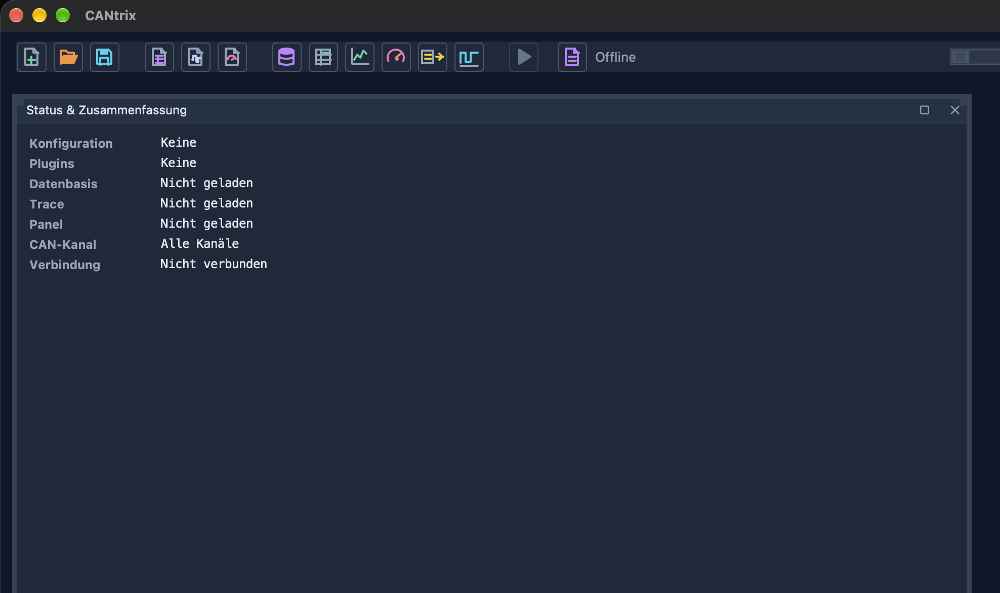
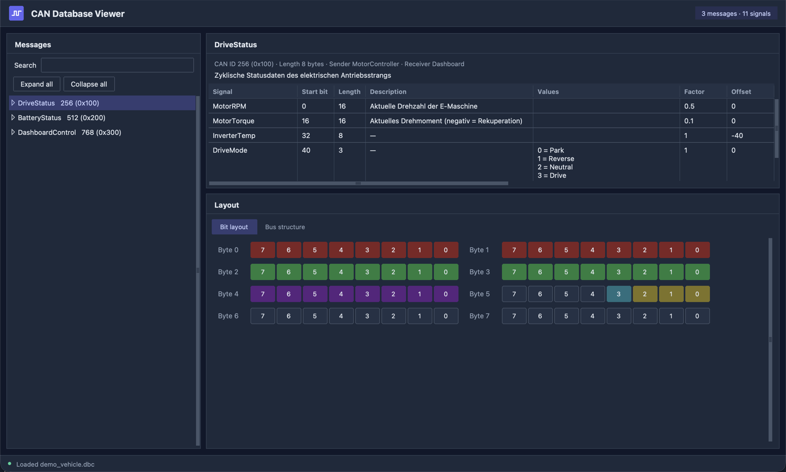
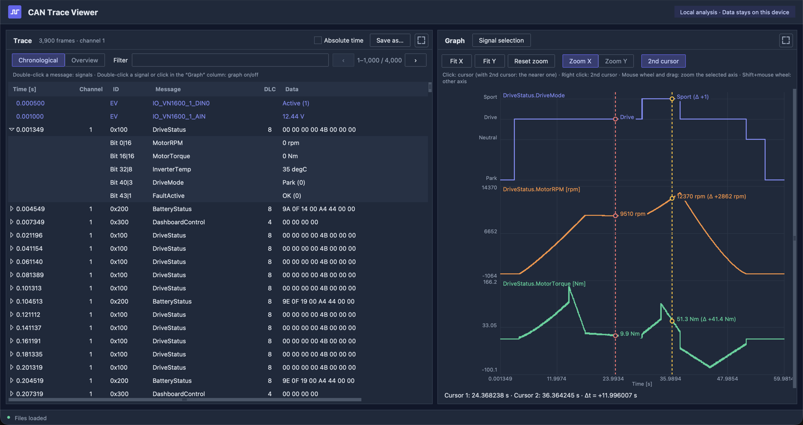
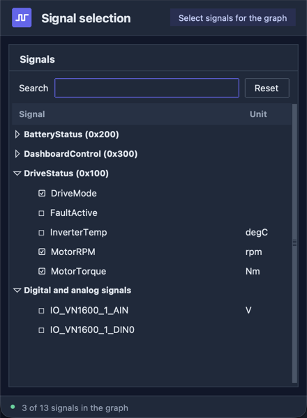
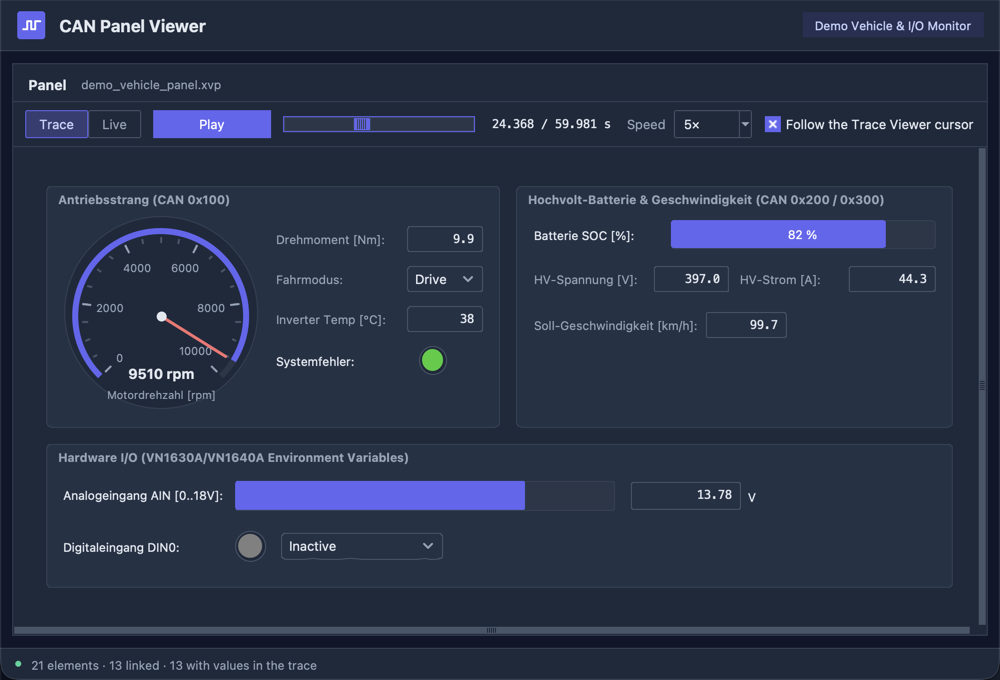

# CANtrix

The CANtrix is a tool for analysing CAN and CAN FD messages. It runs on Windows and macOS. Running from source requires Python 3 with Tkinter. Live recording and TRACE32 use additional packages depending on the interface. All data stays on your own computer.

- **Database Editor:** shows CAN databases (DBC, ARXML, HTML message catalogue) with messages, signals, bit layout and bus structure.
- **Trace Viewer:** opens CAN traces (ASC, BLF, MF4, TRC, candump, BUSMASTER, SLCAN, CSV, PCAP; see "Supported trace formats"), decodes the signals with the database and shows their values as a graph with zoom and cursor.
- **Panel Viewer:** shows Vector panels (`.xvp` from the CANalyzer/CANoe Panel Designer) with values from the trace: gauge, numeric fields, selection boxes, LEDs and bars, linked to signals or environment variables.
- **Plugins:** runs your own Python scripts, optionally with the loaded trace.
- **Configurations:** database, trace, panel, window layout and plugins can be saved as `.canconfig` and loaded again.


© 2026 Frank Hoheisel


## Installation

Recording in the Trace Viewer (data source "Live") needs python-can. It can be installed in a terminal window with the following command.

```bash
pip3 install --user python-can
```

Depending on the CAN device (chosen under "Settings > CAN Trace Recorder > Interface") you also need:

- **Vector devices (VN, VX, VH, … – any model the Vector driver supports):** the Vector driver (Vector XL Driver Library, vxlapi64.dll), Windows only.
- **USBtingo:** the plugin `python-can-usbtingo` and, on macOS, the libusb library (Windows includes it); no separate driver is needed.
- **OBDLink MX+ / ELM327:** `pyserial` and a serial port for the adapter.
- **TRACE32 (variables in the Trace Viewer):** the package `lauterbach-trace32-rcl` (`pip3 install --user lauterbach-trace32-rcl`), see chapter "TRACE32 variables".

```bash
pip3 install --user python-can-usbtingo
brew install libusb   # macOS only
```

If `brew` is not in the PATH (Apple Silicon), `/opt/homebrew/bin/brew install libusb` works. Without libusb, "Test connection" reports "cannot find a suitable libusb-1.0".

The setup scripts install `python-can` and the optional packages `python-can-usbtingo`, `pyserial`, and `lauterbach-trace32-rcl`.

Alternatively by double-click:

- Windows: Batch/01 - install_python-can_Windows.bat
- macOS: Batch/01 - install_python-can_MacOS.command (on the first start, right-click > Open if macOS blocks the file)

## Start

```bash
python3 Sourcen/CANtrix.py
```

Or by double-click:

- Windows: Batch/02 - start_CANtrix_Windows.bat
- macOS: Batch/02 - start_CANtrix_MacOS.command (on the first start, right-click > Open if macOS blocks the file)

Optionally a configuration can be passed, e.g. `"Batch\02 - start_CANtrix_Windows.bat" my.canconfig`


### Building the app and executable

The scripts under `Batch/03` build the app or executable for the current operating system. The scripts under `Batch/05` also create `CANtrix.zip`. The macOS script builds the app locally and fetches the Windows executable from GitHub Actions. It requires an authenticated `gh` session. GitHub builds the pushed state of the branch. The `05` scripts clean up their temporary files on exit.

## Usage

### Main window

Databases, CAN traces and panel are opened only in the main window, through the menu "File" or the icons in the header. Database Editor, Trace Viewer and Panel Viewer are opened through the menu "View" and all use the same databases and the same trace.

The icons below "CANtrix" in the header:

- The first three create a new configuration, load a configuration and save it (without a loaded configuration you are asked for a file name).
- The next three open the windows "Databases" and "CAN traces" and a panel.
- The icons to their right open Database Editor, Trace Viewer (table), Graph Viewer (graph), Panel Viewer, Generator, and Logic Analyzer.
- Next comes the Start/Stop toggle (at rest the triangle to start; while recording or playing the highlighted square to stop) and the data source toggle: it shows the active source, Trace (page) or Live (radio waves, highlighted); next to it "Offline" (Trace) or "Online" (Live) is shown; a click switches to the other one. An icon that cannot be used stays grey.
- On the right are the time slider, time, speed and the checkbox "Follow the Trace Viewer cursor".



### Databases

A configuration can contain several databases. "File > Databases…" (Cmd/Ctrl+D) or the icon in the header opens the window "Databases": the list with file, CAN channel, contents (number of messages and signals) and path at the top, the form below.

- "Choose…" adds one or more files as new databases; they get the CAN channel chosen in the form.
- To change one, click its row, change file or CAN channel and choose "Apply"; "Remove" takes it out of the list, "New" clears the form.
- CAN channel "All channels": the database applies to all frames. With a channel it applies only to the frames of this channel and takes precedence there. This way, for example, two buses with the same IDs but different messages can be analysed.
- Every change applies to all windows right away; the list is saved with the configuration. Unchanged files are not read again.
- The main window lists every database with its channel and contents; a file that could not be read is marked red. The Database Editor groups the messages by database.

### CAN traces

A configuration can contain several CAN traces, which are treated as one single trace after loading. "File > CAN traces…" (Cmd/Ctrl+O) or the icon in the header opens the window "CAN traces", built like the window "Databases": the list with file, contents (frames, start time, beginning in the combined trace) and path at the top, the form with file, "Choose…" (also several files), New, Add/Apply, Remove below.

- Traces with a start time (e.g. the `date` line in ASC) are aligned by the absolute time: the earliest one begins at 0 s, the others accordingly later. This fits consecutive recordings as well as simultaneous ones from different buses; the order in the list does not matter then.
- A trace without a start time (e.g. SLCAN) follows the end of the previous one in the list.
- Frames and values of environment variables of all traces are merged by time; Trace Viewer, Panel Viewer and status show one trace. The main window lists every file with frames, start time and beginning in the combined trace.
- Every change applies right away; the list is saved with the configuration. Unchanged files are not read again.
- With multiple traces or a selected time range, **Pass the current trace to the plugin** creates a temporary ASC file with the corresponding data.

### Configurations

The menu "File" saves database, trace, panel, plugins and window settings as a configuration (`.canconfig`) and loads them again. "New configuration" starts empty. The last 5 configurations are listed directly in the menu "File".

### Database Editor

The Database Editor shows the messages of the database with their signals (start bit, length, factor, offset, value texts, description …) and the bit layout of each message. After the messages follows the entry "Environment variables" with the environment variables of a DBC (type, minimum, maximum, unit, initial value, description, value texts, access and nodes).

**Editing (DBC files only):** The Database Editor only displays ARXML and HTML databases (read-only).

With exactly two databases loaded, **Show differences only** displays messages and signals that differ. Messages are matched by CAN ID and signals by name. **Green** marks additions, **red** removals, and **blue** changes. The file with the later modification time is treated as the newer version. With equal or unavailable timestamps, entries present in just one file have no colour. Hover over the checkbox for the legend.

**Save as DBC…** exports the database of the selected message, signal or environment variable. With no selection, it exports the first loaded database. For DBC sources, it copies the complete text, including unsaved edits. For HTML and ARXML sources, it converts the parsed messages, signals, value tables and available node information.

Conversion loses information outside the parsed model, such as additional nodes, vendor-specific attributes and bus or PDU hierarchy. Names are converted to unique DBC identifiers of up to 32 characters where needed. Missing signal properties default to little endian, unsigned, factor 1, offset 0 and bounds of 0. Value tables retain integer values. When the frame format is unspecified, payload lengths above eight bytes imply CAN FD and IDs above 0x7FF imply extended addressing. Duplicate CAN IDs with the same addressing format or invalid signal positions produce an error.

**Save as ARXML…** exports messages and signals from the same selection as AUTOSAR R22-11. It generates CAN clusters, physical channels, frames, I-PDUs and signal mappings. It carries over bit positions, lengths, byte order, signedness and available linear scaling, limits and units. Messages without a bus name go into the “CAN” cluster.

ARXML export omits value tables, comments, environment variables, ECU assignments and multiplexing rules. Signal bit positions are preserved. Missing byte order defaults to little endian. When the frame format is unspecified, payloads above eight bytes imply CAN FD and the identifier determines extended addressing. Duplicate IDs within the same cluster and addressing format produce an error.

- Below the header: "New" (creates a new, empty DBC file and adds it to the databases), "Save" (writes all changed files), "Undo"/"Redo" (also Cmd/Ctrl+Z and Cmd/Ctrl+Y).
- On the left "New message" and "New variable". Above the signal table "Edit…", "New signal", "Duplicate" and "Delete" for the selection (message, signal or environment variable). A double click on a tree entry or table row opens "Edit…". With several databases a command applies to the file of the selection; "New message" and "New variable" without a selection use the first DBC file.
- In the bit layout a click on a bit selects its signal. The selected signal can be moved with the mouse (drag) or changed in length (Shift+drag); Intel and Motorola signals are handled correctly. The new position is applied when the mouse button is released, and only if the signal fits into the message.
- IDs above 0x7FF are extended IDs and get the extended flag (bit 31), as usual in DBC files.
- Only the affected lines of the file are changed. Everything else (attributes, node list, signal groups, comments, order) stays as it is. When a message ID or signal name changes, the comments, value texts and attributes that refer to it change along. New senders, receivers and access nodes are added to `BU_`. References in signal groups (`SIG_GROUP_`) and relational attributes (`BA_REL_`) are neither copied nor renamed. A file with mixed line endings is written with the prevailing one throughout.
- Nothing is written before "Save". Before the first save of a file the editor creates `<file>.bak`. Afterwards the analyser reads the databases again, so Trace Viewer, Panel Viewer and status show the change. When the window is closed, another configuration is loaded or the analyser quits, it asks about unsaved changes.



### Trace Viewer

Trace table and graph are two separate windows, opened through "View > Trace Viewer" and "View > Graph Viewer" (or the icons in the header). Both work with the same data, the same signal selection and the same cursors; you can also open just one of them. Each window is closed on its own.

Besides the CAN frames, the trace table can show the values of the environment variables in the trace (checkbox "Environment variables" in the title row of the trace area, off at first) and CAN errors (checkbox "CAN errors", off at first). First the environment variables: e.g. the digital and analog inputs and outputs of a VN1600 (`ev IO_VN1600_1_DIN0 = 1`, `ev IO_VN1600_1_AIN = 12.44`). They appear in time order between the frames, with "EV" in the column ID and the value in the column Data, with unit or value text from the database (e.g. `12.44 V`, `Active (1)`). In the overview each variable has one row with its last value and the number of values. The filter finds them by their name; selecting a CAN channel does not hide them, as they belong to no channel. The signal selection of the graph offers them regardless of the checkbox.

CAN errors (error frames) appear in red in time order between the frames: "ERR" in the column ID, the description in the column Data (e.g. `Error Frame ECC: 10100010` or, with SocketCAN, `Error Frame: Bus off`). They belong to a channel and therefore follow the CAN channel selection; the overview has one row per channel with the count. They are read from Vector ASC (`ErrorFrame`), BLF, candump and PCAP/PCAPNG; when saving only ASC keeps them. The frame count counts neither environment variables nor errors.



"Signal selection" in the title row of the Graph Viewer opens a window of its own with all signals, grouped by message (name and ID, collapsed at first). Then follow the group "Digital and analog signals" (environment variables of the inputs and outputs, e.g. `IO_VN1600_1_DIN0`, `IO_VN1600_1_AIN`) and, if there are any, the group "Environment variables" with all others. A click on a signal adds it to the graph or removes it; the search shows only matching signals and expands their groups. "Reset" removes all signals from the graph. With the "Window" selector in the title row of the graph you can create up to 5 graph windows; only one is shown at a time. Each has its own signals, zoom and cursors, all saved in the configuration. Likewise the trace area has a "Window" selector with up to 5 trace windows (each with its own view, filter, page, checkboxes and expanded messages). Environment variables can also be switched on and off in the trace table via the column "Graph".



In the graph a click sets the cursor; its time is shown below the graph. The switch "Zoom X" (default) / "Zoom Y" in the toolbar of the graph selects which axis the mouse wheel and dragging zoom: with "Zoom X" the time axis, with "Zoom Y" the value axis of the curve under the mouse. Shift+mouse wheel zooms the other axis. "Fit X", "Fit Y" and "Fit all" adjust the axes again. The choice is saved with the configuration.

The button "2nd cursor" adds a second cursor (yellow). Next to the value of each signal it shows the difference to the first cursor (e.g. `9422 rpm (Δ +5817 rpm)`); below the graph the times of both cursors and their difference Δt are shown. While it is active, a click moves the nearer cursor; a right click (on macOS also Ctrl+click) always sets the second cursor and switches it on if needed. Both cursors are saved with the configuration.

With the check box "Time of day" in the title row of the trace section, the table additionally shows date and time of each frame on the far left (`dd.mm.yyyy hh:mm:ss.xxx`), with the time in seconds next to it. The check box is off by default; the setting is saved with the configuration. The absolute time is the start of measurement in the trace (for ASC the line `date`, e.g. `date Tue Aug 11 01:32:42.560 pm 2026`) plus the time of the frame; negative timestamps are taken into account as well. If the trace contains no start of measurement (e.g. SLCAN), "—" is shown.

With the button "Description" in the title row of the trace section, the table shows an additional column "Description" on the far right with the comments from the database: the description of the message for messages, of the signal for signals and of the variable for environment variables. The button is off by default; the setting is saved with the configuration (per trace window).

"Settings > CAN Trace Viewer" selects the CAN channel shown by the Trace Viewer (or "All channels"). The choice is saved in the configuration. If a loaded trace contains only one channel, it is selected automatically.

In the main window, **Trace/Live** switches the Trace Viewer and Panel Viewer between the loaded trace and live recording. **Start** opens the Trace Viewer if needed and starts recording via Vector, USBtingo, or OBDLink / ELM327. The table and graph follow the recording until you page back or zoom. **Fit X** resumes following. The recorder keeps up to 100,000 CAN frames. Switching to **Trace** stops recording. The recording remains available under **Live** until the next start. **Clear** discards the live recording even while it is running and resets its time base.

In **Settings → CAN Trace Recorder**, choose the interface and bit rates. For Vector, **Find devices** fills in the selected adapter’s serial number and channel. For USBtingo, leave the USB serial number blank to use the first device. The OBD interface uses a serial port. These options are saved in the application settings.

**Test connection** shows the result in the dialog. The indicator is grey before and during the test, green on success, and red on failure.

New recorder settings use CANcase defaults: Vector, channel 0 and CAN FD at 500,000 / 2,000,000 bit/s. The Vector application name is configurable and defaults to “CANoe”. Vector CAN FD exposes SJW, TSEG1 and TSEG2 for both arbitration and data. The defaults are 15 / 64 / 15 and 8 / 11 / 8. **Calculate from bit rates** fills in the timing for the entered rates. USBtingo uses the bit rates and the optional USB serial number. When CANoe is connected concurrently, the Vector timing must match its channel configuration.

### OBDLink MX+ and ELM327

In **Settings → CAN Trace Recorder**, select **OBDLink / ELM327** and enter the serial port, for example `/dev/cu.OBDLinkMX…` on macOS or `COM7` on Windows. The serial baud rate (default 115200) is separate from the CAN bit rate. The adapter must be available as a serial port. For source runs, the scripts under `Batch/01` install `pyserial`.

**Test connection** checks adapter communication and starts the passive monitor, including on an idle CAN bus. Live recording captures Classical CAN data frames on one channel. Generator sends briefly interrupt monitoring. ELM327 firmware without USER1 support uses standard protocols at 250 or 500 kbit/s. In that case, the active protocol determines which identifier width can be received.

The computer timestamps incoming frames. Serial and Bluetooth delays affect timing, and frames may be lost under high bus load or while sending. The adapter provides no CAN FD, error frames, or reliable Rx/Tx direction. This feature was tested with a simulated serial adapter.

### Vector I/O

**Settings > Vector I/O Configuration** configures the CH5 pins of a VN1640 or VN1640A. In **Overview**, select an adapter discovered by the Vector XL Driver or enter its serial number manually. The cycle time is configurable from 1 to 100 ms. In **Pin configuration**, you can enable and name the analog input, both digital inputs, and the digital output individually.

**OK** generates a separate DBC for the enabled pins and loads it into the current configuration. The device, pin, and cycle settings are saved in the `.canconfig`. This dialog provides configuration and DBC definitions. Cyclic hardware sampling and output are outside its current scope.

### TRACE32 variables

In the live state the Trace Viewer can also read variables of a running Lauterbach TRACE32 debugger and show them in the trace table (checkbox "TRACE32" in the title row of the trace area, settings under "Settings > TRACE32").

**Requirements**

- Python 3.7 or newer (the package `lauterbach-trace32-rcl` does not run with Python 3.6; error "future feature annotations is not defined").
- The package for the remote API: `pip3 install --user lauterbach-trace32-rcl` (Windows: `py -3.11 -m pip install lauterbach-trace32-rcl`). For source runs, the `Batch/01` setup scripts also install the TRACE32 RCL library. Newly built apps and executables bundle it.
- A running TRACE32 debugger with an active connection to the target.

**Configuring TRACE32**

TRACE32 must offer the remote control (RCL) over TCP. In the TRACE32 configuration (`config.t32`) check or add:

```
RCL=NETTCP
PORT=20000
```

Host and port in the dialog must match; for a local connection use `localhost` and port 20000. The target must be readable in the desired state. Whether variables can be read while the program is running depends on the target and the TRACE32 configuration; if necessary, choose the matching memory access setting for the controller in TRACE32.

**Entering and reading variables**

1. Set the checkbox "TRACE32". Without variables the dialog opens, otherwise use "Settings > TRACE32".
2. Enter host, port, variables (one per line or comma separated, e.g. `Status_st.externalTemperature_f32`) and the polling interval in milliseconds (default 100).
3. Start the recording in the main window (data source "Live"). Values are read only while recording.

Use **Open watch file…** to add `VAR.ADDWATCH` entries from a `.cmm` file to the existing variable list. During recording, the TRACE32 row shows connection status with a gray, green, or red indicator.

**OK** creates an additional DBC under `~/.cantrix_data/TRACE32` for the imported symbols and loads it into the current configuration. The DBC defines readable environment variables with the `TRACE32_` prefix. If a DBC name is adjusted, its comment contains the original symbol name. During live recording, successful reads update the environment variables in the Trace Viewer and any panels bound to them. ASC export includes the recorded values.

TRACE32 must resolve variable names in the loaded symbol set. The Trace Viewer reads scalar values directly and shows symbols that can only be read as memory as a list of bytes. A C preprocessor macro (`#define`) is readable only if there is a corresponding symbol in target memory.

**Display**

When a value changes, a row is created (green, "T32" in the column ID, the value in the column Data). In the overview each variable has one row with its last value and the number of changes. The time is based on polling and not synchronous to the CAN frame.

**Troubleshooting**

- Connection error in the status line: check the RCL configuration, host, port and firewall.
- "ERR: …" as value: check the expression or symbol; for a structure enter a single field.
- No CAN reception: check the Vector driver, device, channel and bit rate (see Installation and "Settings > CAN Trace Recorder").

### Panel Viewer

"File > Open panel…" loads a Vector panel (`.xvp`) and shows it in the Panel Viewer. Its elements show the values of the linked signals and environment variables (e.g. `ev IO_VN1600_1_AIN = 12.44` in the trace) at one point in time. The point in time is chosen (playing, the time slider and cursor following also work without a loaded panel; then the Panel Viewer stays closed, the main window keeps the time and the Trace Viewer follows it):

Clicking a panel button (e.g. "config") opens the panels it refers to, each in its own Panel Viewer window. The files are looked up in the folder of the panel with the button. A panel that is already open is brought to the front.

Several panels can be open at the same time (multiple selection in the file dialog, or "Open panel…" several times): each gets its own Panel Viewer window and is saved in the configuration. All panels show the same time; the time slider, Start/Stop and cursor following belong to the first open panel. Closing a panel window removes its panel from the configuration. On the command line `-p` can be given several times.

- with the time slider in the main window (the time is next to it),
- with "Start" and "Stop" in the main window (state "Trace"; the speed (0.5× to 1000× or ∞ = infinite, jumps straight to the end; default 100×) is next to it in the main window, the space bar also starts and stops; playing always begins at the start of the trace),
- or, with the check box "Follow the Trace Viewer cursor" ticked (also in the main window), at the cursor of the graph in the Trace Viewer.

Trace and graph in the Trace Viewer follow the time: while playing, the table shows only the frames up to the current time (and scrolls along), the graph only the curves up to it (the time axis stays the same). After "Stop" everything is shown again. When the time slider is moved nothing is hidden: in the graph only the cursor moves, the table jumps to that time and shows the row in the middle. A new trace, switching the data source or closing the Panel Viewer ends it. The view "Fixed position" (one row per message) always shows all frames.

With "Live" chosen in the main window the Panel Viewer shows the messages the Trace Viewer is recording instead (the last received value of each); the time slider and playing are locked then. Environment variables generated from a TRACE32 watch file are also available live.

Moving the mouse over an element shows in the status bar what it is linked to and its value.



### Generator

"View > Generator" (or the icon in the header) opens the window "CAN Generator" for sending CAN messages. "Add message" opens a selection of the messages of the database (search field, multiple selection); the entry gets their ID and length, the data is 0. "Empty message" creates a free entry (directly without a database). A right click on a frame row of the trace table ("Add to generator"; also on a signal row below it) takes over ID and data of the frame. The ID is shown as `0x…`; input with or without `0x` is read as hexadecimal. Each entry has:

- ID and data (hexadecimal). If the ID is in the database its name is shown, and "Signals…" opens a dialog in which the physical values of the signals are entered (a selection for value tables); the data is calculated from them. IDs above 0x7FF are sent as extended frames, more than 8 bytes as CAN FD (needs the CAN FD mode under "Settings > CAN Trace Recorder").
- "Send" sends once. With a key (a character or a name such as `F5`, `space`) the message is sent when the key is pressed in the window (not while the cursor is in an input field).
- "Cyclic" sends repeatedly at the set interval (period, unit ms); "Stop cyclic sending" stops all of them. An error ends cyclic sending.

Messages are sent over the connection of the recording: choose the data source "Live" and press "Start". The entries (without the state "cyclic") are saved in the configuration; nothing sends on its own.

### Logic Analyzer (USBtingo)

"View > Logic Analyzer (USBtingo)" opens a window laid out like PulseView: the time axis on top, below it the level of the CAN RX line (`CAN`), the individual bits (`CAN: Bits`, stuff bits blue) and the decoded CAN fields (`CAN: Fields`: ID, control bits, data bytes `DB`, CRC, ACK, EOF; also CAN FD with bit rate switching). For this the USBtingo samples the level of the CAN RX line (like "USBtingoGUI > Logic"); the recording is stored as a Sigrok file (`.sr`) that can also be opened in PulseView.

- **Recording:** the red dot starts and the red square stops the recording; it is then shown. If a live recording with the USBtingo is already running, its connection is shared, otherwise the window opens the USBtingo itself. This needs `python-can` and `python-can-usbtingo` (chapter "Installation"; on macOS also libusb).
- **Settings:** bit rate, CAN FD and data rate control the decoding (default from "Settings > CAN Trace Recorder"); a change decodes again. "Sample rate" applies to the next recording ("Auto" = ten times the bit rate or data rate). Decoding needs at least 4 samples per bit.
- **Operation:** the mouse wheel zooms, dragging pans (also Shift+wheel and the scroll bar), a double click on a bit or field zooms to it. Hovering over a bit or field shows its meaning and time in the status bar. "Show all" shows the whole recording.
- **Files:** the open icon loads a Sigrok file (`.sr`, one channel or the channel `CAN`), the save icon copies the recording to a place of your choice.
- The CRC is shown but not checked.

### Appearance and language

- "View > Move to menu bar" (macOS) or "View > Move to system tray" (Windows) hides all windows and shows the CANtrix icon in the menu bar or system tray. Its menu opens the main window, Database Editor, Trace Viewer, Graph Viewer, Panel Viewer, Generator, Logic Analyzer and the plugins of the configuration. On macOS the Dock icon disappears while no window is open. Closing the main window then only hides it; "Quit" ends the program. "Leave menu bar" or "Leave system tray" brings the windows back. CANtrix always starts normally.
- "View > Docked view" shows the status summary, Database Editor, Trace Viewer and Panel Viewer not as separate windows but as windows inside the main window. They can be moved by the title bar, resized at the edges and corners, maximised with the square (also by double-clicking the title bar) and closed with the cross; a click brings a window to the front. The status summary comes back through "View > Main window". Position and size are remembered and stored in the configuration. Switching reopens open windows in the other form (a running recording or playing ends). Auxiliary windows such as the signal selection stay separate windows.
- "View > Dark Mode" switches all windows between a light and a dark design. Dark mode is the default.
- "View > Language" switches the user interface between German and English. As long as nothing has been chosen there, the language follows the operating system: German if the system language is German, otherwise English (also if the system language cannot be determined).
- Both settings are kept for the next start.

"Info > Help" shows this description in the program.


## Supported database formats

Database Editor, Trace Viewer and Panel Viewer use the database opened in the main window. The format is detected from the file extension; files up to 100 MB are read.

| Format | File extension | Access |
| --- | --- | --- |
| Vector DBC | `.dbc` | read and write |
| AUTOSAR ARXML | `.arxml` | read and export |
| HTML message catalogue | `.html`, `.htm` | read |

### Vector DBC (`.dbc`)

- Messages (`BO_`) with ID, length and sender.
- Signals (`SG_`) with start bit, length, byte order (Intel/Motorola), signedness, factor, offset, minimum, maximum, unit, receivers and multiplexing.
- Comments on messages and signals (`CM_`) and value tables (`VAL_`).
- Environment variables (`EV_` with access type, nodes, comment and value table), which the Database Editor shows and edits and the Panel Viewer uses e.g. for the I/O of a VN1600.

### AUTOSAR ARXML (`.arxml`)

- CAN frames via their frame triggerings, with ID, length, bus (communication cluster), sending and receiving ECUs and description.
- Signals from the I-signal I-PDUs, with start position, length, byte order, data type, limits, unit and description.
- Linear conversion (factor/offset) and value texts from the compu methods.

### HTML message catalogue (`.html`, `.htm`)

- Exported message catalogues with one section per frame (bus, ID, length, senders, receivers).
- Signals with position, data type, range, unit, scaling and computation as well as value texts.
- Also the compressed variant with embedded packed data.

### Notes

- Several databases can be loaded at the same time, also mixed from DBC, ARXML and HTML (see "Databases").
- Signals show the real value (factor and offset of the database; with an HTML message catalogue the offset is read from the computation, e.g. `PH = (DEC - 100.0)`). In the trace table the raw value in hex follows the value, e.g. `22 °C (0x7A)`; the graph shows the real value.
- For decoding, the databases are linked to the frames of the trace via the CAN ID (standard and extended); a database with a CAN channel only to frames of this channel. If an ID is in several databases for all channels, the first one in the list wins.


## Supported trace formats

The Trace Viewer and the Panel Viewer read the following formats. The format is detected from the content of the file, not from its extension (e.g. `.log` from candump or BUSMASTER). None of the formats needs python-can.

| Format | File extension | Access |
| --- | --- | --- |
| Vector ASC | `.asc` | read and write |
| Vector BLF | `.blf` | read and write |
| ASAM MDF4 | `.mf4`, `.mdf` | read and write |
| PEAK PCAN-View | `.trc` | read and write |
| BUSMASTER | `.log` | read and write |
| Linux candump | `.log` | read and write |
| SLCAN/Lawicel | `.txt` | read and write |
| PCAP/PCAPNG (SocketCAN) | `.pcap`, `.pcapng` | read and write |
| Intrepid Vehicle Spy | `.vsb` | read |
| CSV (also SavvyCAN/GVRET, python-can) | `.csv` | read and write |
| python-can SQLite | `.db` | read |

### Vector

- **ASC** (`.asc`): CAN and CAN FD, also environment variables (`ev NAME = value`) as well as status and error lines.
- **BLF** (`.blf`): binary format of CANalyzer/CANoe, also compressed; CAN and CAN FD.

### ASAM MDF4 (`.mf4`, `.mdf`)

- CAN bus logging according to ASAM (`CAN_DataFrame`, e.g. from Vector, python-can or asammdf).
- Or simple channels `ID`/`CAN_ID`, `DLC` and `DataBytes`.
- Also compressed. MDF 3 is not supported.
- Signal logging without CAN frames (only decoded signals with a time channel, e.g. from CANape): each numeric signal appears like an environment variable (checkbox "Environment variables" in the trace table, signal selection "Environment variables" in the graph). Text and array channels are skipped, linear conversions are applied.

### Other tools

- **PEAK PCAN-View** (`.trc`): versions 1.0 to 2.1, CAN and CAN FD.
- **BUSMASTER** (`.log`): hexadecimal or decimal, with absolute, relative or system time.
- **Linux candump** (`.log`): format of `candump -l` (`(time) can0 123#11223344`, CAN FD with `##`) and the screen output of candump. The channel is the name of the interface (e.g. `can0`).
- **SLCAN/Lawicel** (`.txt`): lines like `t1238112233445566778899AA` with an optional timestamp in milliseconds; without timestamps each line counts as 1 ms.
- **PCAP/PCAPNG** (`.pcap`, `.pcapng`): SocketCAN captures, e.g. from Wireshark or tcpdump.
- **Intrepid Vehicle Spy** (`.vsb`): binary format (`icsbin`, version 0x104) of neoVI/ValueCAN; CAN and CAN FD, Rx/Tx, start of measurement from the hardware time. Read only, no saving.

### CSV (`.csv`)

- Header line with columns for time, ID and data, optionally channel, direction and DLC.
- Separated by comma, semicolon or tab.
- Also the CSV format of python-can.
- Also SavvyCAN/GVRET CSV (`Time Stamp,ID,Extended,Dir,Bus,LEN,D1,…`): time in microseconds, bus counts from 0 (becomes channel 1…).
- **python-can SQLite** (`.db`): capture of python-can's `SqliteWriter` (table `messages`); one channel only, no direction.

### Notes

- Remote frames are skipped. Turn on **CAN errors** to see recognised error frames in the trace table.
- For formats with absolute clock time (candump, PCAP, CSV) the time starts at 0 with the first frame.
- ASC can contain environment variables, status lines, and CAN errors. Numeric MDF4 signal channels also appear as environment variables.
- The start of measurement for the absolute time comes from: ASC (`date` line, also with am/pm or as `2026-04-01 04:32:56 +0000`), BLF and MDF4 (file header), TRC (`$STARTTIME`), BUSMASTER (start date in the header) as well as candump, PCAP and CSV (Unix time, converted to local time). SLCAN has none.
- Negative timestamps in ASC traces are read.

### Saving a trace

Use **Save as…** in the Trace Viewer to export to a writable format from the table above. For `.log`, the selected file type determines whether to write BUSMASTER or candump. BUSMASTER is the default for `.log`.

Use **right-click → Copy to clipboard** to copy the same export as Vector ASC text. Select a time range using the two orange markers on the main window’s time slider.

- Export includes all CAN channels regardless of the table filter. With multiple traces, it exports the combined trace. If a time range is selected, the exported range starts at 0 s.
- ASC keeps environment variables and CAN errors. A trace with environment variables and no CAN frames can be saved as ASC.
- Extended IDs are detected by their size (above 0x7FF), CAN FD by the data length (above 8 bytes).
- Not every format can hold everything: SLCAN knows only one channel; candump, SLCAN and PCAP store no direction (Rx/Tx); BUSMASTER stores times to 0.1 ms, SLCAN to 1 ms.
- Formats with a clock time (e.g. ASC, BLF, candump, PCAP) get the start of measurement of the loaded trace, without one the time of saving.


## Plugins

Plugins are Python scripts in the folder `Plugins` (also in subfolders).

### Setup

In "Plugins > Configure plugins…" you choose a script and give it a name. Optionally arguments can be given (e.g. `--serve`).

With the check box "Pass the current trace to the plugin" the script gets the path of the loaded trace as its last argument, or in place of `{trace}` in the arguments.

### Plugins and configurations

Plugins belong to their configuration (`.canconfig`), so every configuration has its own plugins. Changes are saved in the open configuration right away. The plugins of the current configuration are listed in the menu "Plugins" and in the status window.

### Running

The script runs in its own folder, and its output appears in a window of its own.
